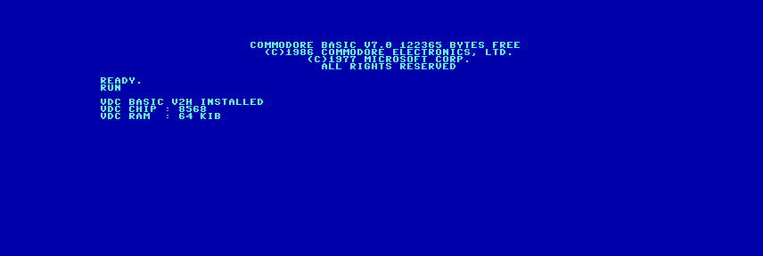

# 1. First contact

Every Commodore 128 has two video chips. One of them is the VIC-II, inherited from the C64, with its sprites and its 40 columns. BASIC 7.0 knows it well: `GRAPHIC`, `DRAW`, `SPRITE`, `MOVSPR` all talk to the VIC.

The other one sits behind the RGB socket. It is called the VDC (the 8563, or the 8568 in the flat C128 D), it shows 80 columns, 640 pixels across, 16 colours, and it can copy and fill its own memory without help from the CPU. BASIC 7.0 has almost nothing to say to it. It can print text on it, and that is all.

VDC-BASIC closes that gap. It adds 23 instructions and 2 functions to BASIC 7.0, and all of them are about the VDC. This book shows what you can build with them.

One thing is worth knowing before we start, because it shapes everything that follows. VDC-BASIC has no command to draw a line and none to draw a circle. It is not that kind of extension. What it gives you is control over the chip's memory: put pictures into it, move them around inside it, decide which part of it appears on the screen. The VDC is very good at moving memory. A game screen, a scrolling landscape, a figure walking in front of a background, a line of text in your own font: all of these turn out to be pictures being copied from one place to another, and that is the kind of work we will hand to the chip.

## What you need

- A C128 (or C128 D) with an 80-column display, or an emulator. VICE's `x128` works well.
- The file `VDCBASIC2H` on a disk. It is the file `vdcbasic2h.bin` from the repository.
- For most of the book: a VDC with 64 KiB of video memory. The flat C128 D has it from the factory, many older machines have been upgraded, and in VICE it is a setting. Examples that need 64 KiB say so in their first lines. This chapter and the next two run with 16 KiB.

## Loading it

VDC-BASIC is a machine language program of a little more than 2 KiB that lives at `$1300`, in the gap below the start of BASIC programs. You load it and start it once:

```
BLOAD "VDCBASIC2H",B0
SYS DEC("1300")
```

It answers with

```
VDC BASIC V2H INSTALLED
```

and from this moment the C128 understands the new words. They are real BASIC keywords: you can type them in direct mode, use them in programs, and `LIST` shows them like any other command. They stay until you reset the machine.

In this book every program loads VDC-BASIC itself in its first lines. That costs a second, and it means each listing runs on its own. Installing it a second time does no harm.

There is one small price for new keywords. BASIC finds keywords anywhere in a line, also inside variable names. `SYN`, `ATTR`, `DISP`, `RST` and the others are now reserved, so a variable called `SYNC` or `DISPLAY` will produce a `?SYNTAX ERROR`. The complete list is in the [command reference](reference/commands.md).

## Writing programs on a PC

You can type everything on the C128 itself. If you prefer to write on a PC and run in an emulator, the tool that turns text into a program file has to know the new keywords, because a BASIC program stores each keyword as a number (a token).

- RetroDevStudio (formerly C64 Studio) reads the file `BASIC V7.0 VDC.txt` from the repository as a BASIC dialect.
- `test/bastok.py` in the repository does the same from the command line: `python3 test/bastok.py program.bas program.prg`.

All listings of this book are in `docs/listings/` as text files.

## The first program

<!-- listing: 01-hello.bas -->
```
10 REM FIRST CONTACT: INSTALL VDC-BASIC AND ASK THE CHIP WHO IT IS
20 BLOAD "VDCBASIC2H",B0:SYS DEC("1300")
30 V=RGD(254):M=RGD(255)
40 PRINT "VDC CHIP : ";:IF V=2 THEN PRINT "8568":ELSE PRINT "8563"
50 PRINT "VDC RAM  :";16+48*M;"KIB"
60 RGW 26,2:REM BACKGROUND COLOUR: DARK BLUE
```



Line 20 is the loading we just discussed.

Line 30 uses the first of the two new functions. `RGD(n)` reads a VDC register. The chip has 37 of them (38 on the 8568), numbered from 0, and they are its control panel: screen size, colours, cursor shape, where in its memory the picture starts. We will meet the important ones one by one.

Registers 254 and 255 do not exist in the chip. VDC-BASIC answers these two itself: 254 gives the version of the chip (0 and 1 are the two generations of the 8563, 2 is the 8568), and 255 tells you how much video memory is installed, 0 for 16 KiB and 1 for 64 KiB. A program that needs 64 KiB should ask and refuse politely instead of drawing garbage.

Line 60 is the first time we change something. `RGW register, value` writes a value into a register. Register 26 holds two colours; its lower half is the background colour of the whole screen. 2 is dark blue.

That one statement recoloured about a hundred thousand pixels. Nothing in memory was changed for it. The chip simply produces a different picture from the same data, because we turned a knob on its control panel. Keep that in mind: a surprising number of effects in this book cost nothing but a register write.

To get the normal colours back, type

```
RGW 26,0
```

or, if you ever lose the screen completely while experimenting,

```
RST 3
```

which puts every register and the character set back to the state after power-on. You may have to type it blind.

## The sixteen colours

The VDC's colours are not the colours of the VIC. They are the 16 colours of an RGBI monitor, the same set the IBM CGA used. We will need the numbers all the time.

| No. | Colour | No. | Colour |
|---|---|---|---|
| 0 | black | 8 | dark red |
| 1 | dark grey | 9 | light red |
| 2 | dark blue | 10 | dark purple |
| 3 | light blue | 11 | light purple |
| 4 | dark green | 12 | dark yellow (brown) |
| 5 | light green | 13 | yellow |
| 6 | dark cyan | 14 | light grey |
| 7 | light cyan | 15 | white |

The number is built from four bits: 8 for red, 4 for green, 2 for blue, 1 for intensity. Light red is 8 + 1 = 9, yellow is red plus green plus intensity, 13.

## What we have so far

| Command | Does |
|---|---|
| `RGD(reg)` | reads a VDC register; 254 = chip version, 255 = memory size |
| `RGW reg, value` | writes a VDC register |
| `RST 3` | emergency exit: default registers and character set |

Next we go behind the control panel, into the memory where the picture lives.

[Next: Two memories](02-two-memories.md)
