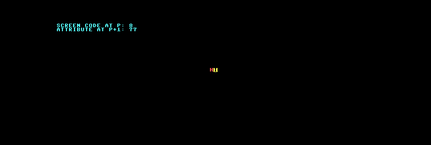
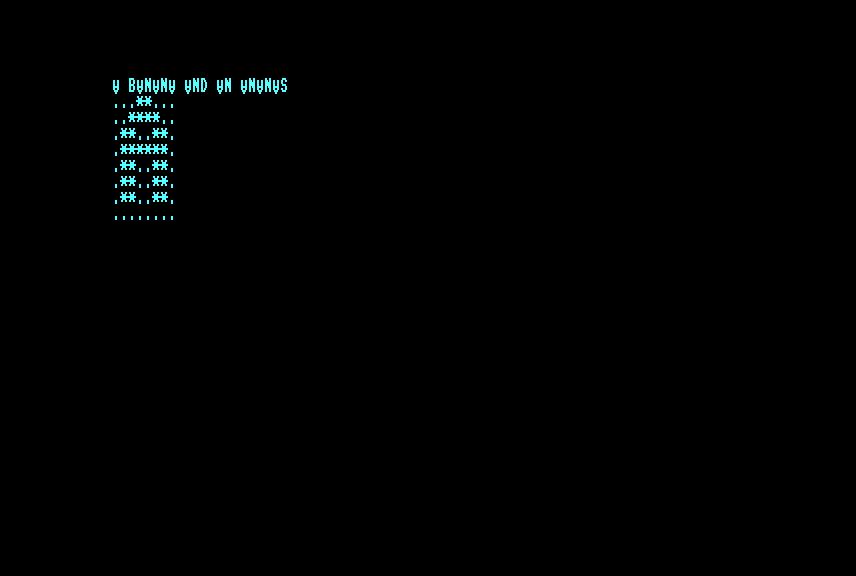

# 2. Two memories

If you have programmed the 40-column screen, you know this trick:

```
POKE 1024,1
```

An "A" appears in the top left corner. The screen is part of the computer's memory, and whatever you `POKE` into the right address shows up.

Try the same on the 80-column screen and nothing happens, whichever address you choose. There is no such address. The picture of the 80-column screen is not in the computer's memory at all.

## A chip with its own memory

The VDC has its own RAM, 16 or 64 KiB of it, soldered next to it and connected to nothing else. The CPU cannot see it. Throughout this book we call it **VRAM**, and we will be strict about the two kinds of address: a *RAM address* is one you can `PEEK` and `POKE`; a *VRAM address* belongs to the VDC.

The only connection between the two worlds is a pair of memory locations, `$D600` and `$D601`. To read one byte of VRAM, a program has to tell the VDC through this door which address it wants, wait until the chip is ready, and ask for the byte. That is slow, and awkward enough that hardly anybody did it in BASIC.

VDC-BASIC does this dance for you. Two commands are the VRAM versions of `PEEK` and `POKE`:

| RAM | VRAM |
|---|---|
| `POKE address, value` | `VMW address, value` (video memory write) |
| `PEEK(address)` | `VMD(address)` |

## The map of VRAM in text mode

When the C128 is switched on, it arranges VRAM like this:

| VRAM address | Size | Content |
|---|---|---|
| 0–1999 (`$0000`–`$07CF`) | 2000 | The characters on the screen, 25 rows of 80 |
| 2048–4047 (`$0800`–`$0FCF`) | 2000 | The attributes: one byte per character with its colour and style |
| 4096–8191 (`$1000`–`$1FFF`) | 4096 | Nothing. Free. |
| 8192–16383 (`$2000`–`$3FFF`) | 8192 | The character set: the shapes of all characters |

With 64 KiB, everything from 16384 upwards is free as well.

This arrangement is a habit of the C128, not a law of the chip. The VDC keeps the start addresses of screen and attributes in registers, and from chapter 4 on we will move them wherever we like. For now we use the map as it is.

The character at row *r*, column *c* (both counted from 0) is at address *r* × 80 + *c*. Its attribute is at the same position in the attribute area, 2048 further up.

## The map of RAM

There is a second map to keep in mind, the one of the computer's own memory. Whenever this book gives a RAM address, it means bank 0 (the VDC-BASIC commands that take RAM addresses ignore `BANK` and always use it). VDC-BASIC and your program share it like this:

| RAM address | Content |
|---|---|
| `$0000`-`$12FF` | System: zero page, stack, Kernal and BASIC work areas |
| `$1300`-`$1BFF` | Free: 2304 bytes for your own data. Lists that must lie below `$4000` can go here. |
| `$1C00`-`$1C0F` | Header of VDC-BASIC: a jump at `$1C00`, the version at `$1C03` (`$30` is v3.0), the threshold of `RXV` at `$1C04` (chapter 6) |
| `$1C10`-`$2EE9` | The code and variables of VDC-BASIC. Everything up to `$3FFF` is reserved for it. |
| `$4000` | A zero byte, the one in front of the program |
| `$4001`- | Your BASIC program |
| above the program | Free: buffers for loading files, command lists, sprite lists (not `$D000`-`$DFFF`, where the I/O chips are) |

This is why the listings of this book use `$8000` for the load buffer and `$A000` for lists: both are far above any program of this size, and a program may grow up to `$8000` before it runs into them. The variables of a BASIC program do not appear in the map; they live in bank 1.

Two consequences. The first is that the VIC bitmap modes `GRAPHIC 1` to `GRAPHIC 4` are off limits, as chapter 1 said: they would use `$1C00`-`$3FFF`. The second is that the 80-column screen has nothing to fear from your program: the VDC has its own memory, and the two maps do not overlap at all.

<!-- listing: 02-direct.bas -->
```
10 REM TWO MEMORIES: WRITE CHARACTERS AND COLOURS STRAIGHT INTO VRAM
20 IF PEEK(46)<>64 THEN PRINT "RUN"CHR$(34)"BOOT"CHR$(34)" FIRST":END
30 PRINT CHR$(147)
40 S=0:C=2048:REM SCREEN AND ATTRIBUTE MEMORY
50 P=12*80+38:REM ROW 12, COLUMN 38
60 VMW S+P,8:VMW S+P+1,9:REM SCREEN CODES OF H AND I
70 VMW C+P,9:REM LIGHT RED
80 VMW C+P+1,13:REM YELLOW
90 VMO C+P+1,64:REM ... AND REVERSED
100 PRINT "SCREEN CODE AT P:";VMD(S+P)
110 PRINT "ATTRIBUTE AT P+1:";VMD(C+P+1)
```



Lines 60 to 90 are the part that matters. Line 60 writes two characters. The values are *screen codes*, the same ones the 40-column screen uses: 1 is A, 2 is B, 8 is H, 9 is I. They are not the codes that `CHR$` and `ASC` work with.

Lines 70 and 80 give the two characters a colour, using the numbers from the table in chapter 1.

## One byte, eight switches

An attribute is more than a colour. The lower four bits are the colour; each of the upper four switches something on:

| Bit | Value | Meaning |
|---|---|---|
| 7 | 128 | use the second character set |
| 6 | 64 | reverse |
| 5 | 32 | underline |
| 4 | 16 | blink |
| 3–0 | 0–15 | colour |

To make the "I" reversed we must set bit 6 and leave the colour alone. With `PEEK` and `POKE` you would write `POKE A, PEEK(A) OR 64`. VDC-BASIC has a command for exactly this:

```
VMO address, value
```

It reads the byte, ORs the value into it, and writes it back: all bits that are 1 in the value get switched on. Line 90 does it. Its sibling `VMA` does the same with AND, which switches bits off: every bit that is 0 in the value is cleared.

```
VMA C+P+1,255-64 : REM reverse off again
VMA C+P+1,240    : REM colour to 0, keep the style bits
```

Clear a group of bits with `VMA`, then set the new ones with `VMO`: you will see this pair of statements again when we plot pixels.

The registers have the same two helpers. `RGA register, value` and `RGO register, value` switch bits in a VDC register off and on. Many registers pack several settings into one byte, so these are what you normally use; a plain `RGW` would overwrite the neighbours. In chapter 1 we were careless: `RGW 26,2` set the background, but it also set the upper half of register 26 to 0. In text mode nobody notices, because every character brings its own colour in its attribute. The careful version would have been `RGA 26,240:RGO 26,2`.

## Shapes are memory too

The last entry of the map is the character set. For every character there are 16 bytes; the first 8 are its picture, one byte per row of pixels, one bit per pixel. The other 8 would be used for taller characters and are normally ignored.

The pattern of screen code *n* therefore starts at 8192 + 16 × *n*. Let us look at the letter A, and then do something silly to it.

<!-- listing: 02-glyph.bas -->
```
10 REM TWO MEMORIES: THE CHARACTER SET IS ORDINARY VRAM, TOO
20 IF PEEK(46)<>64 THEN PRINT "RUN"CHR$(34)"BOOT"CHR$(34)" FIRST":END
30 PRINT CHR$(147);"A BANANA AND AN ANANAS"
40 G=DEC("2000")+16*1:REM PATTERN OF SCREEN CODE 1, THE LETTER A
50 DIM B(7)
60 FOR R=0 TO 7:B(R)=VMD(G+R):NEXT
70 FOR R=0 TO 7:B=B(R)
80 : FOR X=0 TO 7:B=B*2
90 : IF B>255 THEN B=B-256:PRINT "*";:ELSE PRINT ".";
100 : NEXT:PRINT
110 NEXT
120 FOR R=0 TO 7:VMW G+R,B(7-R):NEXT:REM TURN EVERY A UPSIDE DOWN
```



Lines 60 to 110 read the eight bytes with `VMD` and print them as dots and stars. There is the A, as the chip stores it.

Line 120 writes the same eight bytes back in reverse order. Look at the first line of the screen: every A is standing on its head, the moment the pattern changes. We did not touch the screen. The screen only says "character number 1 here"; what number 1 looks like is decided in a different part of VRAM, and the chip puts the two together fifty or sixty times per second.

`RST 2` reloads the original character set.

This is the second time something changed everywhere at once although we changed very little. The VDC composes its picture from several pieces of memory, according to its registers, again and again for every frame. Change a piece or a register, and the next frame is different. Much of this book is about arranging the pieces so that the change we want is a small one.

## What we have so far

| Command | Does |
|---|---|
| `VMW vaddr, value` | writes a byte to VRAM |
| `VMD(vaddr)` | reads a byte from VRAM |
| `VMO vaddr, value` | switches bits on in a VRAM byte |
| `VMA vaddr, value` | switches bits off in a VRAM byte |
| `RGO reg, value` | switches bits on in a register |
| `RGA reg, value` | switches bits off in a register |

We can now reach every byte the VDC owns, and we know where our own bytes live. But one byte at a time, from BASIC, is slow. Painfully slow, as the next chapter will measure. Then we let the chip do it.

[Next: The chip does the work](03-the-chip-does-the-work.md)
