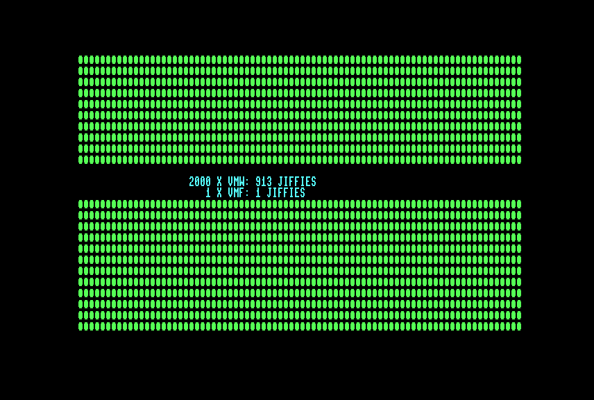
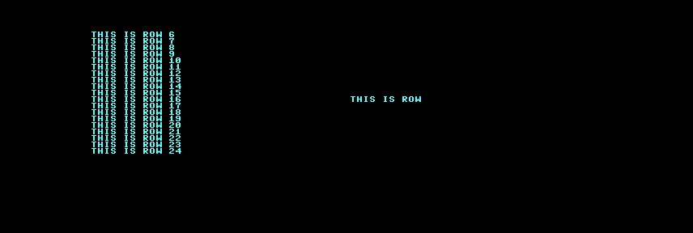

# 3. The chip does the work

Let us fill the screen with a character. All of it, 2000 positions. We know how:

```
FOR I=0 TO 1999:VMW I,102:NEXT
```

Run it and watch. You can follow the characters appearing one after the other, row by row. It takes about fifteen seconds.

Fifteen seconds for one screenful. A picture in bitmap mode has 16000 bytes. At this speed we could not even clear it in two minutes, let alone animate anything.

The loop is not slow because the VDC is slow. It is slow because BASIC has to read the line, find the variable, convert the numbers and call the command 2000 times. The actual writing is a tiny part of it. So the way out is not a faster loop. It is no loop.

## Fill

The VDC can fill a stretch of its memory with one value on its own. You tell it where, with what, and how many bytes; it does the rest while the CPU waits. VDC-BASIC calls this

```
VMF address, value, count
```

for "video memory fill".

<!-- listing: 03-fill.bas -->
```
10 REM THE CHIP DOES THE WORK: 2000 WRITES AGAINST ONE FILL
20 IF PEEK(46)<>64 THEN PRINT "RUN"CHR$(34)"BOOT"CHR$(34)" FIRST":END
30 T=TI:FOR I=0 TO 1999:VMW I,102:NEXT:T1=TI-T
40 T=TI:VMF 0,81,2000:T2=TI-T
50 VMF 2048,5,2000:REM ALL ATTRIBUTES: LIGHT GREEN
60 VMF 10*80,32,240:REM CLEAR THREE ROWS FOR THE RESULT
70 CHAR ,20,11,"2000 X VMW:"+STR$(T1)+" JIFFIES"
80 CHAR ,20,12,"   1 X VMF:"+STR$(T2)+" JIFFIES"
```



Line 30 is the loop, with a stopwatch around it. `TI` counts sixtieths of a second, called jiffies.

Line 40 fills the same 2000 bytes with a different character, using one `VMF`.

915 jiffies against 1. And the 1 is mostly BASIC reading the statement.

The remaining lines use the new command three more times, because it is so handy: line 50 gives all 2000 attributes the colour light green, line 60 clears three rows in the middle by filling them with spaces (screen code 32), and then the result is printed there.

`VMF` is the command you will use to clear things: a screen, a colour area, a buffer. `VMF 0,32,2000` clears the text screen faster than you can see.

## Copy

The second thing the VDC can do alone is copy. Take a number of bytes from here, put them there:

```
VMC source, target, count
```

for "video memory copy". Both addresses are VRAM addresses; the copy never leaves the chip. That is exactly why it is fast: nothing has to go through the narrow door at `$D600`.

What is it good for? The 80-column screen of the C128 scrolls rather sluggishly when it is full, because the operating system moves every character through the CPU. With `VMC` we can do better.

<!-- listing: 03-scroll.bas -->
```
10 REM THE CHIP DOES THE WORK: SCROLL THE TEXT SCREEN WITH TWO STATEMENTS
20 IF PEEK(46)<>64 THEN PRINT "RUN"CHR$(34)"BOOT"CHR$(34)" FIRST":END
30 PRINT CHR$(147);:FOR I=1 TO 24:PRINT "THIS IS ROW";I:NEXT
40 FOR N=1 TO 5
50 : SYN
60 : VMC 80,0,1920:REM ROWS 1-24 MOVE UP TO ROWS 0-23
70 : VMF 1920,32,80:REM BLANK THE BOTTOM ROW
80 NEXT
90 VMC 3*80,10*80+40,11:REM ONE PIECE OF A ROW, SOMEWHERE ELSE
```



Line 30 prints 24 numbered rows, so we can see what moves.

Line 60 is the scroll. Row 1 starts at address 80. We copy from there to address 0, the start of row 0, and we copy 1920 bytes, which is 24 rows. Every row lands one row higher. The top row is overwritten and gone.

Line 70 clears the bottom row, which still shows its old content.

That is one scroll step, and lines 40 and 80 repeat it five times. The `SYN` in line 50 waits for the moment when the VDC has finished drawing a frame, so that we do not change the screen while it is being displayed; we will come back to it in chapter 8.

To keep the listing short, the program moves only the characters. Since all rows have the same colour here, nobody notices. A complete scroll moves the attributes as well: `VMC 2128,2048,1920`.

Line 90 shows that a copy does not have to be a whole row or start at a row boundary. It takes 11 bytes from the start of row 3 and puts them into the middle of row 10. Bytes are bytes; the chip does not care that we think of them as rows.

## A word about overlap

In the scroll, source and target overlap: we copy rows 1–24 onto rows 0–23. This works because the VDC copies in ascending order. It reads a byte, writes it 80 positions lower, and moves on to the next. Every byte is read before the copy reaches the place where it would be overwritten.

Scrolling *down* is a different matter. `VMC 0,80,1920` looks right and is wrong. The chip copies the first byte of row 0 to row 1, and a little later, when it arrives at row 1, it reads what it has just written there. The result is row 0 repeated all the way down the screen.

So the rule is:

> Copying to a **lower** address may overlap. Copying to a **higher** address must not.

There are two ways around it, and we will use both later. One is to copy through a free area of VRAM. The other is to copy row by row, starting with the last one, which a single `VMC` can do once we know its additional parameters. That is chapter 7.

Sometimes the "wrong" behaviour is exactly what you want. `VMC A,A+1,99` copies the byte at A to A+1, then that to A+2, and so on: a fill with whatever is at A. With a larger distance it repeats a pattern: `VMC A,A+8,792` repeats the eight bytes at A a hundred times.

## What we have so far

| Command | Does |
|---|---|
| `VMF vaddr, value, count` | fills *count* bytes of VRAM with one value |
| `VMC source, target, count` | copies *count* bytes from one place in VRAM to another |
| `SYN` | waits until the current frame has been displayed |

These two commands, fill and copy, are the heart of VDC-BASIC. Nearly everything from here on is built on them: more parameters for them, clever places to copy from, and clever places to copy to.

So far we have only pushed characters around. In the next part we switch the VDC to bitmap mode and give ourselves a canvas.

[Next: A canvas](04-a-canvas.md)
