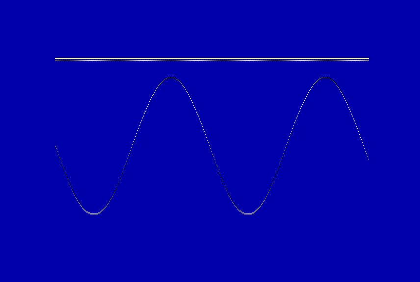
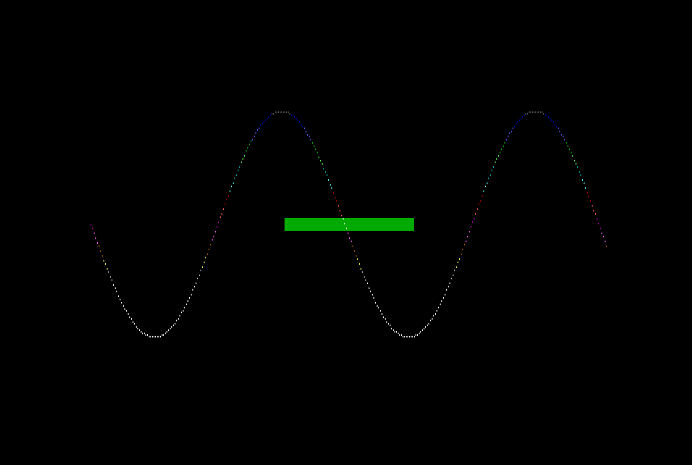

# 4. A canvas

Until now the VDC has been drawing characters. For every position on the screen it looked up a number in screen memory, fetched the shape with that number from the character set, and painted it. One bit in one register changes that.

## Bitmap mode

Register 25 is one of those registers that pack several settings into one byte. Its top bit is the one we want:

```
RGO 25,128
```

From this moment the VDC stops looking up shapes. It takes the bytes of screen memory and puts them on the screen directly: every bit is a pixel, eight pixels per byte, 80 bytes per line. That makes 640 pixels across. The screen has 200 lines, so the whole picture is 80 × 200 = 16000 bytes.

The pixel at column *x*, line *y* is in the byte at *y* × 80 + INT(*x* / 8), counted from the start of the bitmap. Within the byte the leftmost pixel is bit 7, value 128, and the rightmost is bit 0, value 1.

<!-- listing: 04-bitmap.bas -->
```
10 REM A CANVAS: 640 X 200 PIXELS, TWO COLOURS. RUNS WITH 16 KIB.
20 BLOAD "VDCBASIC2H",B0:SYS DEC("1300")
30 FOR I=0 TO 7:READ B(I):NEXT:DATA 128,64,32,16,8,4,2,1
40 RGA 25,191:REM ATTRIBUTES OFF: ONE PAIR OF COLOURS FOR THE WHOLE SCREEN
50 RGO 25,128:REM BITMAP MODE ON
60 DISP 0:REM THE BITMAP STARTS AT VRAM ADDRESS 0
70 VMF 0,0,16000:REM CLEAR ALL 200 LINES
80 RGW 26,DEC("D2"):REM YELLOW ON DARK BLUE
90 VMF 20*80,255,80:REM A SOLID LINE
100 VMF 22*80,DEC("AA"),80:REM A DOTTED LINE
110 FOR X=0 TO 639 STEP 2
120 : Y=INT(110+70*SIN(X/50))
130 : VMO Y*80+INT(X/8),B(X AND 7)
140 NEXT
150 GETKEY K$
160 RST 3:PRINT CHR$(147)
```



Line 50 switches to bitmap mode. Line 60 uses a new command: `DISP` sets the address in VRAM where the displayed data begins. It was 0 already; we say it anyway, because from now on we decide where things are, and it is good to see it written down.

Line 70 clears the canvas, and you know now why this must be a `VMF`.

Lines 90 and 100 draw by filling. A byte of 255 is eight set pixels, so 80 of them are a line across the whole screen. `$AA` is binary 10101010: a dotted line.

Lines 110 to 140 plot single pixels, 320 of them, along a sine curve. Line 130 is the whole plotting routine: compute the byte, and switch on one bit in it with `VMO`. The values of the eight bits come from the little table `B()`, filled in line 30.

You can watch the curve crawl across the screen. This is the speed of drawing pixel by pixel in BASIC, and it is the reason this book goes a different way. Still, it is good to know how, and for a diagram that is drawn once it is fast enough.

Lines 150 and 160 wait for a key and clean up. `RST 3` is not optional here, as we are about to see.

## Where did the colours come from?

Line 40 switched something *off*: bit 6 of register 25, the attributes. Without attributes the whole screen has one ink colour and one paper colour, and both come from register 26: ink in the upper half, paper in the lower. Line 80 sets yellow on dark blue. The border around the picture has the paper colour.

We switched the attributes off because of the map from chapter 2. Look at what the bitmap covers:

| VRAM address | Text mode | Now |
|---|---|---|
| 0–1999 | characters | bitmap lines 0–24 |
| 2048–4047 | attributes | bitmap lines 25–50 |
| 4096–8191 | free | bitmap lines 51–102 |
| 8192–16383 | character set | bitmap lines 102–199, 384 bytes left over |

The bitmap needs 16000 of the 16384 bytes. It rolls over the old attributes and over the character set. If we had left the attributes on, the VDC would have taken the colours from the middle of our own picture. And when the program ends, the text screen needs its character set back: that is the `RST 3`, and the `PRINT CHR$(147)` clears what the bitmap left in screen memory.

So this is what a 16 KiB machine can do: 640 × 200 in two colours, with almost nothing to spare. It is a fine mode for a diagram, a title picture or a page of text in a special font. For more, we need more memory.

## The big map

With 64 KiB there is room for everything, and room to keep things in reserve. But the chip has to be told. Even a VDC with 64 KiB wakes up believing it has 16, and until it is corrected every address above 16383 lands somewhere in the lower 16 KiB. One bit corrects it:

```
RGO 28,16
```

Do this first, before anything is written to VRAM. And since a program should not assume what kind of machine it runs on, ask before you rely on it: `RGD(255)` is 1 if 64 KiB are there.

Now we can lay out VRAM as we please. For a bitmap with colours:

| VRAM address | Size | Content |
|---|---|---|
| 0–15999 | 16000 | bitmap |
| 16000–17999 | 2000 | attributes |
| 18000–65535 | 47536 | free |

The VDC learns about this through two commands: `DISP` for the start of the bitmap and `ATTR` for the start of the attributes.

In bitmap mode an attribute has a different meaning than in text mode. There is one attribute for each cell of 8 × 8 pixels, 80 × 25 of them, and it holds two colours:

| Bits | Meaning |
|---|---|
| 7–4 | paper: the colour of all 0 pixels in the cell |
| 3–0 | ink: the colour of all 1 pixels in the cell |

`$4F` is white ink on dark green paper. Reverse, underline and blink do not exist here.

<!-- listing: 04-colour.bas -->
```
10 REM A CANVAS WITH COLOUR CELLS. NEEDS 64 KIB VRAM.
20 BLOAD "VDCBASIC2H",B0:SYS DEC("1300")
30 IF RGD(255)=0 THEN PRINT "THIS PROGRAM NEEDS 64 KIB VRAM":END
40 FOR I=0 TO 7:READ B(I):NEXT:DATA 128,64,32,16,8,4,2,1
50 RGO 28,16:REM USE ALL 64 KIB
60 BM=0:AT=16000:REM BITMAP AND ATTRIBUTES
70 VMF BM,0,16000:VMF AT,DEC("0F"),2000:REM WHITE ON BLACK
80 DISP BM:ATTR AT:RGO 25,128
90 FOR X=0 TO 639 STEP 2
100 : Y=INT(100+70*SIN(X/50))
110 : VMO BM+Y*80+INT(X/8),B(X AND 7)
120 NEXT
130 REM NOW ONLY THE ATTRIBUTES CHANGE: 2000 BYTES INSTEAD OF 16000
140 FOR R=3 TO 17:VMF AT+R*80,R-2,80:NEXT:REM INK COLOUR PER ROW
150 VMF AT+12*80+30,DEC("4F"),20:REM WHITE ON DARK GREEN
160 GETKEY K$
170 RST 3:PRINT CHR$(147)
```



Lines 50 to 80 set up the map. Notice the order: both areas are cleared *before* line 80 switches the display to them, so nobody sees garbage flash by.

The curve is drawn as before, in white.

Then lines 140 and 150 change colours and do not touch a single pixel. Line 140 gives each row of cells its own ink colour. Line 150 gives twenty cells in the middle a green paper. The curve runs through all of it unchanged.

Two things are worth taking away from this.

The first is a limit: within one 8 × 8 cell there are only two colours. Where two differently coloured objects meet inside a cell, one of them gets the wrong colour. Everybody who has drawn on a C64 or a Spectrum knows this problem.

The second is an opportunity. A picture in this mode has two layers, shape and colour, and the colour layer is eight times smaller. Changing 2000 bytes of attributes is a matter of an instant for `VMF` and `VMC`. In the next chapter we take this idea to its extreme, and the limit of two colours per cell disappears along the way.

## What we have so far

| Command | Does |
|---|---|
| `RGO 25,128` | bitmap mode on |
| `RGA 25,191` | attributes off: colours from register 26 |
| `RGO 28,16` | make all 64 KiB reachable. First thing in the program. |
| `DISP vaddr` | where the displayed characters or the bitmap begin |
| `ATTR vaddr` | where the displayed attributes begin |
| `RST 3` | back to the normal text screen; follow it with `PRINT CHR$(147)` |

[Next: Sixteen colours per pixel](05-sixteen-colours.md)
