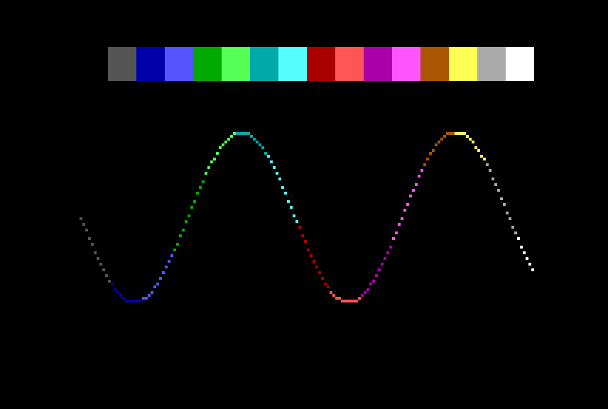

# 5. Sixteen colours per pixel

*Everything from here on needs 64 KiB of VRAM unless a chapter says otherwise.*

At the end of the last chapter we had a picture in two layers: a bitmap that says where ink and paper are, and attributes that say which colours those are, cell by cell. The cells were 8 pixels wide and 8 lines high, and the two colours per cell were a nuisance.

What if the cells were much smaller?

## Shrinking the cell

The width of a cell is fixed: 8 pixels, one byte of bitmap. But the height is just a number in a register. Register 9 holds the number of scan lines per character row, minus one. It is 7 for the normal 8 lines. Nothing stops us from writing 1 into it. Then a cell is 8 pixels wide and 2 lines high, the screen has 100 rows of cells instead of 25, and there are 80 × 100 = 8000 attributes.

That is better, but a cell still has only two colours. Now comes the trick. We fill the *entire bitmap* with the same byte:

```
00001111
```

In every cell on the screen, the left four pixels are paper and the right four are ink. And then we never touch the bitmap again. All it does from now on is cut every cell into a left half and a right half.

Look at what the attributes have become. The upper four bits of an attribute are the paper colour: the colour of the left half. The lower four bits are the ink colour: the colour of the right half. Each half is a block of 4 × 2 of the VDC's small pixels, and since those small pixels are twice as high as they are wide, the block is a square.

We have a screen of 160 × 100 square pixels, each of which can have any of the 16 colours, with no restrictions whatsoever. The picture is entirely in the attribute memory:

> One byte is two pixels. The upper four bits are the left pixel, the lower four bits the right one.

`$00` is two black pixels. `$FF` is two white ones. `$2D` is a dark blue pixel followed by a yellow one. A complete picture is 8000 bytes.

## The recipe

Making the cells smaller means the VDC has to count differently in the vertical direction, so a few more registers must agree with register 9. We put the whole setup into a subroutine at line 9000. It will be at the end of nearly every listing from now on.

```
9000 REM --- 160 X 100 PIXELS, 16 COLOURS. NEEDS 64 KIB VRAM ---
9010 IF RGD(255)=0 THEN PRINT "THIS PROGRAM NEEDS 64 KIB VRAM":END
9020 RST 1:RGO 28,16
9030 T=(RGD(4)+1)*8+(RGD(5) AND 31):V=RGD(7)
9040 RGW 9,1:RGW 4,T/2-1:RGW 6,100:RGW 7,V*4
9050 VMF 0,15,16000:VMF 16000,0,8000
9060 DISP 0:ATTR 16000:RGO 25,128
9070 RETURN
```

Line 9010 checks the memory.

Line 9020 starts from a known state. `RST 1` resets all registers and leaves the character set alone. Then all 64 KiB are switched on.

Line 9030 reads how the machine is set up. Registers 4 and 5 hold the total height of a frame, counted in character rows plus a few extra lines; `T` is that height in scan lines, 312 on a PAL machine and 264 on an NTSC machine. Register 7 says in which row the picture is sent back to the top; it decides where the picture sits on the monitor.

Line 9040 is the heart of it. Two lines per row (`RGW 9,1`). The same total height as before, now counted in rows of two lines (`RGW 4,T/2-1`). 100 rows are displayed (`RGW 6,100`). And the row for the return to the top is multiplied by 4, because rows are now a quarter as high. Because the values are calculated from what the machine reports, the same lines work on PAL and NTSC machines.

Line 9050 fills the bitmap with the magic byte 15, which is `00001111`, and clears the picture to black.

Line 9060 tells the VDC where bitmap and attributes are, and only then switches to bitmap mode.

This gives us the map that the rest of the book uses:

| VRAM address | Size | Content |
|---|---|---|
| 0–15999 | 16000 | the bitmap: 16000 times the byte 15. Never changes. |
| 16000–23999 | 8000 | the picture on the screen |
| 24000–65535 | 41536 | free: room for five more pictures of the same size |

In the listings the variable `P` holds the start of the picture, 16000. The byte of the pixel at column *x*, row *y* is at `P + Y*80 + INT(X/2)`.

## Trying it out

<!-- listing: 05-chunky.bas -->
```
10 REM SIXTEEN COLOURS PER PIXEL: THE 160 X 100 MODE
20 BLOAD "VDCBASIC2H",B0:SYS DEC("1300")
30 GOSUB 9000:P=16000:REM P = START OF THE PICTURE
40 FOR C=1 TO 15:VMF P+C*5,C*17,5:NEXT:REM ONE LINE OF COLOUR BARS ...
50 FOR R=1 TO 11:VMC P,P+R*80,80:NEXT:REM ... COPIED ELEVEN TIMES
60 FOR X=0 TO 159
70 : Y=INT(60+30*SIN(X/12)):C=1+(X/11 AND 15)
80 : GOSUB 500
90 NEXT
100 GETKEY K$
110 RST 3:PRINT CHR$(147):END
500 REM --- PLOT PIXEL X,Y IN COLOUR C ---
510 A=P+Y*80+INT(X/2)
520 IF X AND 1 THEN VMA A,240:VMO A,C:RETURN
530 VMA A,15:VMO A,C*16:RETURN
9000 REM --- 160 X 100 PIXELS, 16 COLOURS. NEEDS 64 KIB VRAM ---
9010 IF RGD(255)=0 THEN PRINT "THIS PROGRAM NEEDS 64 KIB VRAM":END
9020 RST 1:RGO 28,16
9030 T=(RGD(4)+1)*8+(RGD(5) AND 31):V=RGD(7)
9040 RGW 9,1:RGW 4,T/2-1:RGW 6,100:RGW 7,V*4
9050 VMF 0,15,16000:VMF 16000,0,8000
9060 DISP 0:ATTR 16000:RGO 25,128
9070 RETURN
```



Line 40 draws one row of colour bars. A bar is five bytes, ten pixels, wide. The value is `C*17` because 17 is `$11`: multiplying a colour by 17 puts it into both halves of the byte, so both pixels get it.

Line 50 copies that row eleven times, one row further down each time. There is the first use of `VMC` on a picture, and a first taste of what the next part of the book is about.

Lines 60 to 90 plot a curve with the subroutine at line 500, which sets one pixel. It needs the pair of commands from chapter 2: `VMA` clears the half of the byte that belongs to our pixel and keeps the other, `VMO` puts the colour in. For an odd *x* that is the lower half; for an even *x* the upper half, and the colour has to be multiplied by 16 to get there.

## Why this mode

It may seem odd to give up three quarters of the resolution on purpose. Here is what we get in return.

**Colour without rules.** Any pixel, any colour. A graphics program on a PC and a converter (chapter 6) are all you need to bring pictures over; no fighting with cells.

**Small pictures.** A full screen is 8000 bytes. A figure of 16 × 16 pixels is 8 bytes × 16 rows = 128 bytes. The free part of VRAM holds five full screens or several hundred such figures.

**Bytes are pixels.** This is the important one. The VDC copies and fills bytes. In the 640 × 200 mode a byte is 8 pixels of shape, and its colour lives somewhere else; to move a coloured object you have to move two things and respect the cells. Here a byte is simply two finished pixels. Everything the chip does with bytes it now does with pixels, and it does it at full speed.

The price is that the chip only moves whole bytes. Without extra effort an object can be placed at even pixel columns only, 0, 2, 4 and so on. In practice that is rarely a problem, and for the transparent edges of sprites there is a way around it (chapter 11).

The 640 × 200 mode keeps its place: for a still picture, or for text on a plain background, where nothing moves and the attributes can stay as they are. For everything that moves, this book uses 160 × 100.

## What we have so far

| Statement | Does |
|---|---|
| `GOSUB 9000` | switches to the 160 × 100 mode (our subroutine) |
| `VMW P+Y*80+X/2, L*16+R` | sets the pixel pair at an even *x* to colours *L* and *R* |
| `VMF address, C*17, count` | a run of pixels in colour *C* |

We have a canvas, and plotting on it is as slow as ever. Time to bring in pictures that were drawn somewhere else.

[Next: Getting pictures into VRAM](06-getting-pictures-in.md)
