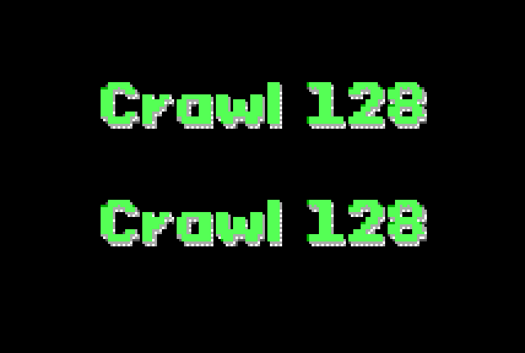

# 6. Getting pictures into VRAM

Nobody wants to draw a dungeon wall with `VMW`. Pictures are drawn on a PC, with whatever program you like, and brought to the C128 as files. This chapter builds the road they travel on.

It has three stations. The disk drive can only deliver into the computer's memory. So a picture goes from disk into RAM, and from RAM across to VRAM:

```
disk  --BLOAD-->  RAM (bank 0)  --RTV-->  VRAM
```

## From RAM to VRAM

The second leg is new. `RTV`, "RAM to VRAM", copies a block of the computer's memory into the VDC's memory:

```
RTV address, vaddr, count
```

Its mirror image is `VTR vaddr, address, count`, "VRAM to RAM", for the way back.

Both always work with RAM bank 0, whatever `BANK` says, and they see the real RAM everywhere, also where BASIC would see ROM. They have to push every byte through the narrow door between the two memories, so they are slower than a copy inside VRAM. A full picture of 8000 bytes takes a little under half a second. Compared with the 915 jiffies of chapter 3 for a quarter of that, we will not complain.

## Where to put the buffer

Bank 0 holds your BASIC program, from `$1C01` upwards. The variables are in bank 1 and do not concern us. Everything in bank 0 above the end of the program is free, and a short program ends far below `$4000`. So the listings in this book use `$4000` as the start of a buffer. That leaves 48 KiB up to the top of memory. If you write a program of more than about 9000 bytes, move the buffer up.

## The file format

A picture file for this book is as simple as it can be:

| Bytes | Content |
|---|---|
| 2 | load address, as in every Commodore program file. Ignored. |
| 1 | width in bytes (half the width in pixels) |
| 1 | height in rows |
| width × height | the picture, row after row, without gaps |

<!-- listing: 06-viewer.bas -->
```
10 REM GETTING PICTURES INTO VRAM: A PICTURE VIEWER
20 BLOAD "VDCBASIC2H",B0:SYS DEC("1300")
30 GOSUB 9000:P=16000
40 BF=DEC("4000"):REM A BUFFER IN CPU RAM, BANK 0
50 BLOAD "DUNGEON",B0,P(BF)
60 BANK 0:W=PEEK(BF):H=PEEK(BF+1):BANK 15
70 RTV BF+2,P,W*H
80 GETKEY K$
90 RST 3:PRINT CHR$(147):END
9000 REM --- 160 X 100 PIXELS, 16 COLOURS. NEEDS 64 KIB VRAM ---
9010 IF RGD(255)=0 THEN PRINT "THIS PROGRAM NEEDS 64 KIB VRAM":END
9020 RST 1:RGO 28,16
9030 T=(RGD(4)+1)*8+(RGD(5) AND 31):V=RGD(7)
9040 RGW 9,1:RGW 4,T/2-1:RGW 6,100:RGW 7,V*4
9050 VMF 0,15,16000:VMF 16000,0,8000
9060 DISP 0:ATTR 16000:RGO 25,128
9070 RETURN
```


Line 50 loads the file into the buffer. The `P(BF)` tells `BLOAD` to put it at our address instead of the one stored in the file.

Line 60 reads width and height. Mind the `BANK 0`: without it, `PEEK` would look into the BASIC ROM, which also lives at `$4000`. `BANK 15` afterwards restores the normal state. This is the one place where `BANK` matters; `RTV` does not care.

Line 70 sends the picture across. The data starts two bytes into the buffer, after width and height. The picture in the file is a full screen, 80 bytes × 100 rows, so it can go straight to `P` in one piece.

That is a picture viewer in five lines.

## Making the files

The road needs a first station on the PC as well: something that turns a PNG into this format. The repository has it in `docs/tools/vdc-converter.html`. It is a single page that you open in a browser, from your disk; it needs no installation and no network.

You give it a picture in its final size, 160 × 100 pixels or smaller. It matches every pixel to the nearest of the 16 VDC colours, shows you the result, and saves a file. It also shows the BASIC lines that load the file. It can make four kinds of file:

| Kind | For | Chapter |
|---|---|---|
| Picture or tile sheet, 160 × 100 mode | full screens and anything to be copied as a rectangle | this one and 7 |
| Sprite with transparency | figures in front of a background | 11 |
| Font sheet | text in your own letters | 10 |
| Picture, 640 × 200 mode | still pictures in two colours | 4 |

The same converter works from the command line, which is handy when many files have to be made again and again: `node docs/tools/vdcconv.js picture in.png out`.

Then the file has to get onto a disk or a disk image, as a `PRG` file. For VICE, `c1541 image.d64 -write out name` does that.

## Pictures that are not on the screen

A full-screen picture can be sent straight to the screen. A smaller one cannot: `RTV` copies one unbroken block, and a small picture on the screen is not an unbroken block. Each of its rows starts 80 bytes after the previous one, with other people's pixels in between.

And there is a better reason to do it differently. Here is the idea that everything in the next part rests on:

> A picture does not have to be on the screen to be in VRAM.

We have 41536 bytes of VRAM that are not displayed. We can keep pictures there, packed tightly, and bring them to the screen with `VMC` whenever and wherever we want. The slow road from the disk is travelled once, at the start of the program. After that everything happens inside the chip.

<!-- listing: 06-title.bas -->
```
10 REM GETTING PICTURES INTO VRAM: A SMALL PICTURE, PARKED OFF SCREEN
20 BLOAD "VDCBASIC2H",B0:SYS DEC("1300")
30 GOSUB 9000:P=16000
40 BF=DEC("4000"):SH=32000:REM BUFFER IN RAM, STORE IN VRAM
50 BLOAD "TITLE",B0,P(BF)
60 BANK 0:W=PEEK(BF):H=PEEK(BF+1):BANK 15
70 RTV BF+2,SH,W*H:REM THE PICTURE IS NOW IN VRAM, BUT NOT ON SCREEN
80 X=3:Y=10:GOSUB 200
90 Y=58:GOSUB 200
100 GETKEY K$
110 RST 3:PRINT CHR$(147):END
200 REM --- SHOW THE STORED PICTURE AT BYTE X, ROW Y ---
210 FOR R=0 TO H-1
220 : VMC SH+R*W,P+(Y+R)*80+X,W
230 NEXT:RETURN
9000 REM --- 160 X 100 PIXELS, 16 COLOURS. NEEDS 64 KIB VRAM ---
9010 IF RGD(255)=0 THEN PRINT "THIS PROGRAM NEEDS 64 KIB VRAM":END
9020 RST 1:RGO 28,16
9030 T=(RGD(4)+1)*8+(RGD(5) AND 31):V=RGD(7)
9040 RGW 9,1:RGW 4,T/2-1:RGW 6,100:RGW 7,V*4
9050 VMF 0,15,16000:VMF 16000,0,8000
9060 DISP 0:ATTR 16000:RGO 25,128
9070 RETURN
```



Line 70 puts the title picture at address 32000, in the free part of VRAM. Nothing appears on the screen.

The subroutine at line 200 shows it at a chosen position, row by row. Row `R` of the stored picture starts at `SH+R*W`, since the rows lie directly one after the other. It goes to row `Y+R` of the screen, `X` bytes from the left edge. One `VMC` per row.

Lines 80 and 90 call it twice. The second copy costs no loading and no extra memory.

(The store is called `SH`, for "sheet", and not `ST`. `ST` is taken: it is BASIC's status variable. `TI` and `DS` are reserved in the same way.)

It works. It is also visibly slow: the loop needs about a second for the 32 rows, and once more it is BASIC that takes the time, not the chip. Thirty-two statements for one picture is thirty-one too many. The next chapter fixes that.

## The way back, and two relatives

`VTR` brings a piece of VRAM into RAM, where it can be saved. A screenshot function is two lines:

```
VTR P,BF,8000
BSAVE "SHOT",B0,P(BF) TO P(BF+8000)
```

(A file saved this way has no width and height bytes in front. To load it with the viewer above, save from two bytes before the data and `POKE` 80 and 100 there first.)

`SWP vaddr, address, count` exchanges a block of VRAM with a block of RAM in one go: what was in VRAM is now in RAM and the other way round. That is a way to keep a second screen in reserve and flip between the two, and on a machine with 16 KiB, where VRAM has no room to spare, it is the only way.

`VCC address, vaddr, count` is a specialist for text mode. It copies character patterns of 8 bytes each from RAM into the character set, where each character has 16 bytes reserved, and skips the unused 8 each time. With it you can load a character set made for the 40-column screen: `VCC BF,DEC("2000"),0` replaces all 256 characters of the first set.

## What we have so far

| Command | Does |
|---|---|
| `RTV address, vaddr, count` | copies from RAM (bank 0) to VRAM |
| `VTR vaddr, address, count` | copies from VRAM to RAM |
| `SWP vaddr, address, count` | exchanges VRAM and RAM |
| `VCC address, vaddr, count` | copies 8-byte character patterns into the character set |

We can now fill VRAM with pictures. In the next part they start to move.
