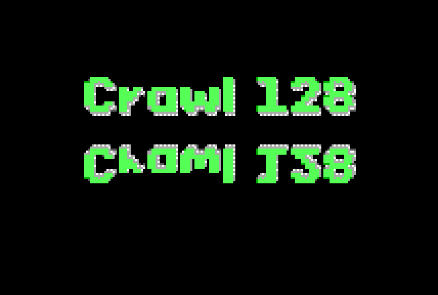
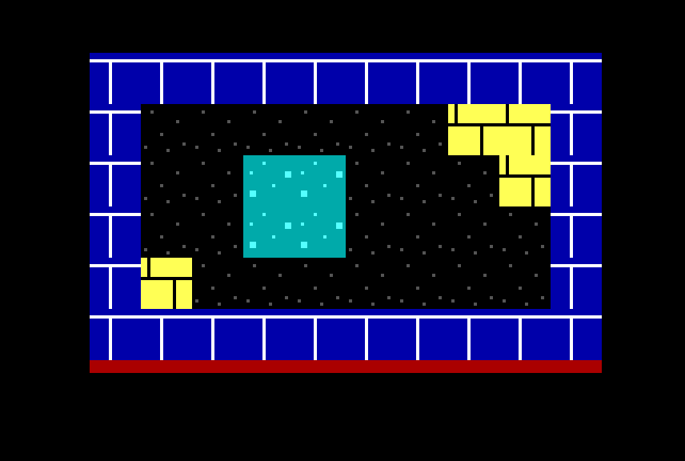
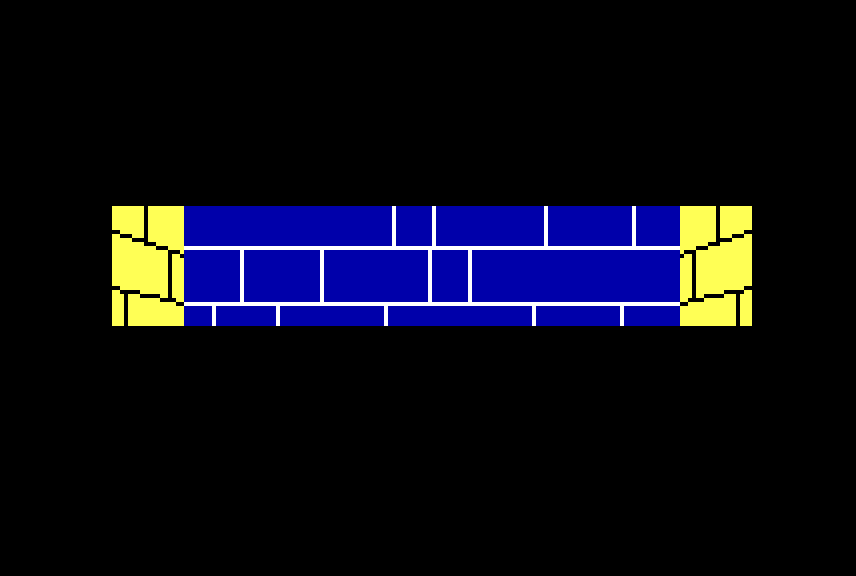

# 7. The blit

At the end of the last chapter a picture of 73 × 32 bytes sat in a hidden corner of VRAM, and a BASIC loop carried it to the screen row by row. Thirty-two `VMC` statements, about a second.

The loop did the same thing every time round: copy one row, then move the target down by one screen row. The only thing that changed was a number. A machine can count that by itself.

## Width, height, step

`VMC` has a longer form:

```
VMC source, target, count, repetitions, targetstep
```

It copies *count* bytes from *source* to *target*, as before. Then it adds *targetstep* to the target address and does it again, and again, *repetitions* times in all.

Read it with a picture in mind: *count* is the width of the picture in bytes, *repetitions* is its height in rows, and *targetstep* is the distance from one screen row to the next, which on our screen is 80.

And the source? It simply carries on. After the first run of *count* bytes, the second run takes the next *count* bytes, and so on. That is exactly how our stored pictures are laid out: packed, row after row, no gaps.

The whole loop of chapter 6 becomes

```
VMC SH,P+Y*80+X,W,H,80
```

This operation, copying a rectangle of picture from one place to another, has had a name since the 1970s: a *block transfer*, or *blit* for short. It is the most important operation in this book.

<!-- listing: 07-mirror.bas -->
```
10 REM THE BLIT: ONE STATEMENT PER PICTURE, AND A PICTURE UPSIDE DOWN
20 BLOAD "VDCBASIC2H",B0:SYS DEC("1300")
30 GOSUB 9000:P=16000
40 BF=DEC("4000"):SH=40000
50 BLOAD "TITLE",B0,P(BF)
60 BANK 0:W=PEEK(BF):H=PEEK(BF+1):BANK 15
70 RTV BF+2,SH,W*H
80 X=3:Y=14
90 VMC SH,P+Y*80+X,W,H,80:REM TOP DOWN
100 VMC SH,P+(Y+2*H+1)*80+X,W,H,-80:REM BOTTOM UP: A REFLECTION
110 GETKEY K$
120 RST 3:PRINT CHR$(147):END
9000 REM --- 160 X 100 PIXELS, 16 COLOURS. NEEDS 64 KIB VRAM ---
9010 IF RGD(255)=0 THEN PRINT "THIS PROGRAM NEEDS 64 KIB VRAM":END
9020 RST 1:RGO 28,16
9030 T=(RGD(4)+1)*8+(RGD(5) AND 31):V=RGD(7)
9040 RGW 9,1:RGW 4,T/2-1:RGW 6,100:RGW 7,V*4
9050 VMF 0,15,16000:VMF 16000,0,8000
9060 DISP 0:ATTR 16000:RGO 25,128
9070 RETURN
```



Line 90 is the blit. Time it, if you like: the second that the loop needed has shrunk to less than a thirtieth of a second.

Line 100 shows a variation. The step may be negative. Here the target starts at the *bottom* row of where the picture should be and moves *up* by 80 after every row, while the source runs forward as always. The first row of the picture lands at the bottom, the last at the top: the picture stands on its head. A reflection in water for the price of a minus sign.

## A room made of tiles

One blit is a picture. Many blits of small pictures make a world. The classic way to build game screens is from *tiles*: a small set of square pictures, and a map that says which tile goes where.

Our tiles are 16 × 16 pixels, which is 8 bytes × 16 rows = 128 bytes each. The file `TILES` holds eight of them. They are stored one after the other, so the picture in the file is 8 bytes wide and 128 rows high, and tile number *T* begins at `SH + T*128`. (To make such a file, draw the tiles below each other in one tall picture and give it to the converter as a picture.)

| No. | Tile |
|---|---|
| 0 | floor |
| 1 | blue brick |
| 2 | yellow brick |
| 3–6 | water surface, four animation steps |
| 7 | water |

<!-- listing: 07-tiles.bas -->
```
10 REM THE BLIT: A ROOM BUILT FROM TILES
20 BLOAD "VDCBASIC2H",B0:SYS DEC("1300")
30 GOSUB 9000:P=16000
40 BF=DEC("4000"):SH=40000:REM BUFFER IN RAM, TILE SHEET IN VRAM
50 BLOAD "TILES",B0,P(BF)
60 BANK 0:W=PEEK(BF):H=PEEK(BF+1):BANK 15
70 RTV BF+2,SH,W*H:REM 8 TILES OF 8 BYTES X 16 ROWS, ONE AFTER THE OTHER
80 FOR R=0 TO 5:READ M$
90 : FOR C=0 TO 9:T=VAL(MID$(M$,C+1,1))
100 : VMC SH+T*128,P+R*16*80+C*8,8,16,80
110 : NEXT
120 NEXT
130 VMF P+96*80,DEC("88"),80,4,80:REM A DARK RED BAR, 4 ROWS HIGH
140 GETKEY K$
150 RST 3:PRINT CHR$(147):END
200 DATA "1111111111"
210 DATA "1000000221"
220 DATA "1007700021"
230 DATA "1007700001"
240 DATA "1200000001"
250 DATA "1111111111"
9000 REM --- 160 X 100 PIXELS, 16 COLOURS. NEEDS 64 KIB VRAM ---
9010 IF RGD(255)=0 THEN PRINT "THIS PROGRAM NEEDS 64 KIB VRAM":END
9020 RST 1:RGO 28,16
9030 T=(RGD(4)+1)*8+(RGD(5) AND 31):V=RGD(7)
9040 RGW 9,1:RGW 4,T/2-1:RGW 6,100:RGW 7,V*4
9050 VMF 0,15,16000:VMF 16000,0,8000
9060 DISP 0:ATTR 16000:RGO 25,128
9070 RETURN
```



The map is in the `DATA` lines at the end, one string per row of tiles, one digit per tile. You can see the room in them.

Lines 80 to 120 walk through the map. Line 100 is the blit: tile `T` from the sheet goes to tile row `R`, tile column `C`. A tile row is 16 screen rows, so its address is `R*16*80`; a tile column is 8 bytes.

Sixty blits take a little over two seconds. You can see the room being laid, tile by tile. Once again that is not the chip: it is BASIC working out sixty statements with their multiplications. Chapter 12 will get rid of most of that. And a screen like this is usually built once and then kept (the next chapter shows where).

Line 130 uses the same extension on the other block command. `VMF` also accepts repetitions and a step:

```
VMF vaddr, value, count, repetitions, step
```

It fills a rectangle. Here: 80 bytes wide, 4 rows high, in dark red (`$88` is two pixels of colour 8). Boxes, bars, backgrounds for text, a cleared window: all one statement.

## Cutting from a large picture

Packed storage is the natural thing for pictures that were made to be blitted. But sometimes the source is a large picture that is itself laid out like a screen, 80 bytes per row, and we want a piece from the middle of it. Then the source must not simply carry on after each row; it has to jump to the next row of the large picture.

For this `VMC` takes one more parameter:

```
VMC source, target, count, repetitions, targetstep, sourcestep
```

After each run, the source moves on by *sourcestep*, counted from the beginning of the run. With 80 it goes down one row of an 80-byte-wide picture.

<!-- listing: 07-cut.bas -->
```
10 REM THE BLIT: CUTTING PIECES OUT OF A LARGE PICTURE
20 BLOAD "VDCBASIC2H",B0:SYS DEC("1300")
30 GOSUB 9000:P=16000
40 BF=DEC("4000"):BG=32000:REM A WHOLE PICTURE, STORED OFF SCREEN
50 BLOAD "DUNGEON",B0,P(BF)
60 RTV BF+2,BG,8000
70 REM FOUR PIECES OF 20 X 30 BYTES, FROM COLUMN X, ROW 10 OF THE PICTURE
80 FOR I=0 TO 3:READ X
90 : VMC BG+10*80+X,P+35*80+I*20,20,30,80,80
100 NEXT
110 DATA 6,30,45,54
120 GETKEY K$
130 RST 3:PRINT CHR$(147):END
9000 REM --- 160 X 100 PIXELS, 16 COLOURS. NEEDS 64 KIB VRAM ---
9010 IF RGD(255)=0 THEN PRINT "THIS PROGRAM NEEDS 64 KIB VRAM":END
9020 RST 1:RGO 28,16
9030 T=(RGD(4)+1)*8+(RGD(5) AND 31):V=RGD(7)
9040 RGW 9,1:RGW 4,T/2-1:RGW 6,100:RGW 7,V*4
9050 VMF 0,15,16000:VMF 16000,0,8000
9060 DISP 0:ATTR 16000:RGO 25,128
9070 RETURN
```



The dungeon picture is stored at `BG`, complete but invisible. Line 90 cuts strips of 20 × 30 bytes out of it, each starting at row 10 and at a column `X` taken from the `DATA` line, and sets them side by side on the screen. The four strips come from different places in the picture and form a new, scrambled wall.

The rule for *sourcestep* is short:

| *sourcestep* | The next run is read from |
|---|---|
| left out, or 0 | directly behind the previous run: packed pictures |
| anything else | the start of the previous run plus *sourcestep* |

Both steps can be negative, and they can differ. With a target step of 160 a picture is drawn on every second row. With the right pair of steps we can finally scroll a screen *down*, which chapter 3 had to leave open:

```
VMC P+98*80,P+99*80,80,99,-80,-80
```

This copies row 98 to row 99, then row 97 to row 98, and so on up to row 0: the last row first, so nothing is overwritten before it has been read.

## Fine print

- *repetitions* can be 1 to 255. A 0 counts as 256.
- If you give *repetitions*, you must give *targetstep* as well.
- A blit does not check anything. If it runs off the bottom of the picture, it writes into whatever comes next in VRAM. If a picture is wider than the space to the right edge, the rest appears at the left edge, one row lower. Keeping pictures inside the screen is the program's job.
- Since a byte is two pixels, a blit can only start at an even pixel column.
- A blit replaces everything in its rectangle. A figure drawn this way brings its background with it as a box. Chapter 11 deals with that.

## What we have so far

| Command | Does |
|---|---|
| `VMC source, target, width, height, 80` | blits a packed picture |
| `VMC source, target, width, height, 80, 80` | blits a piece out of a full-width picture |
| `VMC source, target, width, height, -80` | the same, upside down, starting at the bottom row |
| `VMF vaddr, value, width, height, 80` | fills a rectangle |

With one statement per picture, things can move. But moving means erasing and drawing again, and that is something nobody should have to watch.

[Next: Two screens, no flicker](08-two-screens.md)
