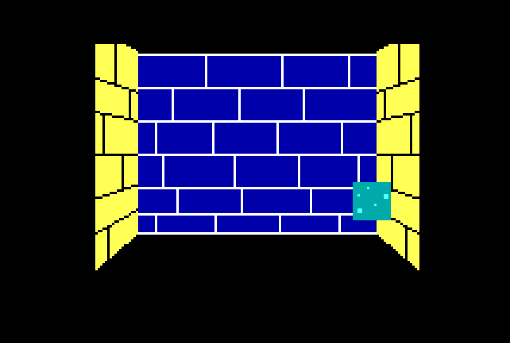

# 8. Two screens, no flicker

Let us move something. A block of water (tile 7, for want of a better actor) is to slide back and forth in front of the dungeon wall.

The background must come back wherever the block has been, so we keep a clean copy of it in VRAM at `BG` and never draw on that. For every step of the animation we wipe the screen with the clean background and draw the block at its new place.

<!-- listing: 08-direct.bas -->
```
10 REM TWO SCREENS: A MOVING BLOCK, DRAWN ON THE VISIBLE SCREEN
20 BLOAD "VDCBASIC2H",B0:SYS DEC("1300")
30 GOSUB 9000:P=16000
40 BF=DEC("4000"):BG=32000:SH=40000
50 BLOAD "DUNGEON",B0,P(BF):RTV BF+2,BG,8000:REM THE BACKGROUND, KEPT CLEAN
60 BLOAD "TILES",B0,P(BF):RTV BF+2,SH,1024
70 VMC BG,P,8000
80 X=2:DX=2:Y=60
90 FOR F=1 TO 40
100 : VMC BG,P,8000:REM WIPE EVERYTHING ...
110 : VMC SH+7*128,P+Y*80+X,8,16,80:REM ... AND DRAW THE BLOCK AGAIN
120 : X=X+DX:IF X<2 OR X>68 THEN DX=-DX
130 NEXT
140 GETKEY K$
150 RST 3:PRINT CHR$(147):END
9000 REM --- 160 X 100 PIXELS, 16 COLOURS. NEEDS 64 KIB VRAM ---
9010 IF RGD(255)=0 THEN PRINT "THIS PROGRAM NEEDS 64 KIB VRAM":END
9020 RST 1:RGO 28,16
9030 T=(RGD(4)+1)*8+(RGD(5) AND 31):V=RGD(7)
9040 RGW 9,1:RGW 4,T/2-1:RGW 6,100:RGW 7,V*4
9050 VMF 0,15,16000:VMF 16000,0,8000
9060 DISP 0:ATTR 16000:RGO 25,128
9070 RETURN
```

Line 100 copies the whole background, 8000 bytes, onto the screen. That takes less than two jiffies; it is hardly slower than restoring just the patch behind the block, and much simpler. Line 110 draws the block. Line 120 moves it and turns it around at the walls.

Run it, and you will see the block move, and you will see it flicker. Sometimes it is there, sometimes it is cut in half, sometimes it is missing altogether.

The reason is that we are painting on the picture while the monitor is showing it. The VDC draws the screen 50 or 60 times per second, top to bottom. For a part of every animation step the block has been wiped away and not yet drawn again. Whenever the chip happens to pass by during that time, you see a frame without the block.

## The second page

The cure is not to paint on the visible picture at all.

There is no law that says the picture on the screen starts at 16000. That number is what we told the VDC with `ATTR 16000`. We have plenty of VRAM. Let us set aside a second area of 8000 bytes, at 24000, and call both of them *pages*.

| VRAM address | Content |
|---|---|
| 0–15999 | the bitmap, as always |
| 16000–23999 | page 0 |
| 24000–31999 | page 1 |
| 32000–39999 | the clean background |
| 40000– | tiles and other sheets |

While page 0 is on the screen, we build the next picture on page 1, in peace: wipe, draw, as slowly as we like. Nobody sees it. When it is finished, we tell the VDC to show page 1 instead. That is one command, `ATTR 24000`, and it changes two registers. The finished picture appears at once and complete. Then the roles are exchanged: page 0 is now the hidden one, and the next picture is built there.

This is called *page flipping* or *double buffering*.

<!-- listing: 08-flip.bas -->
```
10 REM TWO SCREENS: THE SAME BLOCK, DRAWN ON THE HIDDEN SCREEN
20 BLOAD "VDCBASIC2H",B0:SYS DEC("1300")
30 GOSUB 9000:PG(0)=16000:PG(1)=24000:REM TWO PAGES
40 BF=DEC("4000"):BG=32000:SH=40000
50 BLOAD "DUNGEON",B0,P(BF):RTV BF+2,BG,8000:REM THE BACKGROUND, KEPT CLEAN
60 BLOAD "TILES",B0,P(BF):RTV BF+2,SH,1024
70 VMC BG,PG(0),8000:V=0:REM V = THE PAGE THAT IS VISIBLE
80 X=2:DX=2:Y=60
90 FOR F=1 TO 40
100 : D=PG(1-V):REM D = THE PAGE WE DRAW ON: THE OTHER ONE
110 : VMC BG,D,8000
120 : VMC SH+7*128,D+Y*80+X,8,16,80
130 : SYN:ATTR D:V=1-V:REM THE FINISHED PAGE BECOMES VISIBLE
140 : X=X+DX:IF X<2 OR X>68 THEN DX=-DX
150 NEXT
160 GETKEY K$
170 RST 3:PRINT CHR$(147):END
9000 REM --- 160 X 100 PIXELS, 16 COLOURS. NEEDS 64 KIB VRAM ---
9010 IF RGD(255)=0 THEN PRINT "THIS PROGRAM NEEDS 64 KIB VRAM":END
9020 RST 1:RGO 28,16
9030 T=(RGD(4)+1)*8+(RGD(5) AND 31):V=RGD(7)
9040 RGW 9,1:RGW 4,T/2-1:RGW 6,100:RGW 7,V*4
9050 VMF 0,15,16000:VMF 16000,0,8000
9060 DISP 0:ATTR 16000:RGO 25,128
9070 RETURN
```



The two page addresses are in the little array `PG()`. `V` is the number of the visible page, 0 or 1, so `1-V` is always the other one. Line 100 puts the address of the hidden page into `D`, the page we draw on.

Lines 110 and 120 are the same two blits as before. Only the target has changed from `P` to `D`.

Line 130 is the flip, and it has a new command in front.

## SYN: waiting for the right moment

Even the flip itself should not happen in the middle of a frame; the upper part of the screen would show the old page and the lower part the new one, for one frame. `SYN` waits until the VDC has drawn the last line of the picture and is on its way back to the top. Whatever we change right after a `SYN` takes effect before the next frame begins.

`SYN:ATTR D` is nearly always good enough. For the careful there is a stricter form. `SYN` can take pairs of register numbers and values:

```
SYN 20,D/256, 21,D AND 255
```

All values are worked out first; then `SYN` waits, and then it writes the registers one after the other in machine language, with nothing in between. Registers 20 and 21 are the two halves of the attribute address, the same that `ATTR` sets. Use this form when several registers have to change in the same frame, for instance a new page and a new colour.

Waiting has a price. The version without pages needs four jiffies per step; this one needs six, because each step now waits for the start of a frame. The movement is a little slower, and far calmer.

## What pages are good for

Animation is the obvious use. But a hidden page is useful any time a picture takes a while to build.

- The room of chapter 7 took two seconds to lay. Build it on the hidden page and flip: the player sees the old picture, then the new one, and never the bricklaying.
- A page can be a store. Build the room once on a page that is never shown, and use it as the clean background from which the visible pages are refreshed. That is exactly what `BG` is in the listing above.
- Two finished pictures can be exchanged instantly and as often as you like: a map and an inventory, day and night.

In the 160 × 100 mode a page costs 8000 bytes, and all pages share the one bitmap. That is why six of them fit into VRAM. In the 640 × 200 mode the same trick works with `DISP` for the bitmap, but there a page is 16000 bytes plus attributes, and three are the limit.

## What we have so far

| Command | Does |
|---|---|
| `ATTR vaddr` | shows another page (160 × 100 mode) |
| `SYN` | waits for the end of the frame |
| `SYN reg, value, reg, value ...` | waits, then writes registers without delay |

The pattern for every moving picture from here on:

```
D=PG(1-V)        : REM the hidden page
VMC BG,D,8000    : REM start from the clean background
...draw...
SYN:ATTR D:V=1-V : REM show it
```

[Next: Scrolling and wide worlds](09-scrolling.md)
