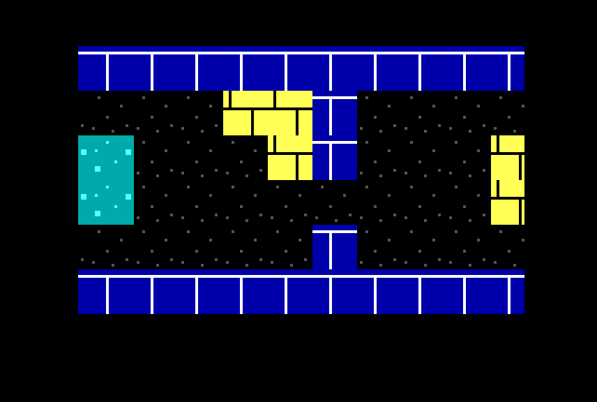
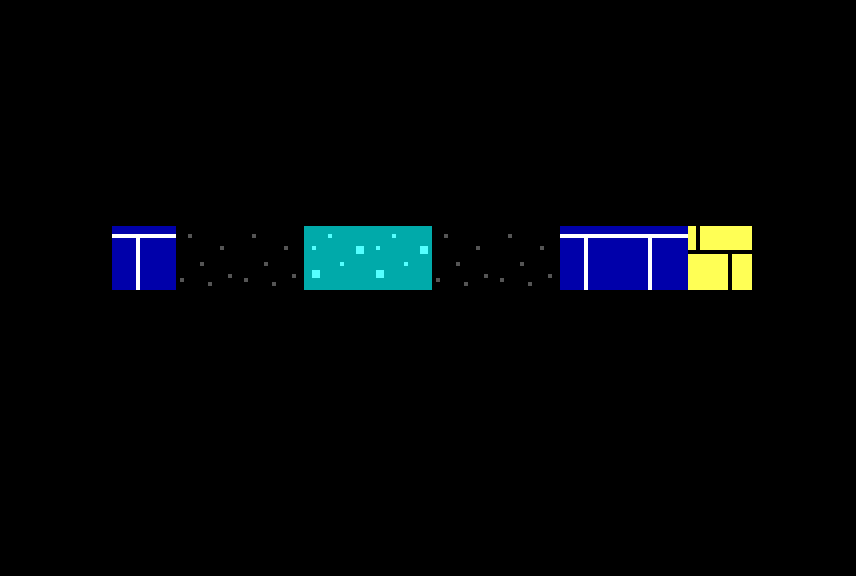

# 9. Scrolling and wide worlds

A world that fits on one screen is a small world. Sooner or later the picture has to move sideways, so that new parts of it come into view. There are two ways to do that, and they are opposites: move the window across the picture, or move the picture past the window.

## Moving the window

In the last chapter we showed a different page by changing the address the VDC starts displaying from. Nothing says that address must be the beginning of a page. If we add 1 to it, the display starts one byte later; every row begins one byte further to the right in memory, and the whole picture appears shifted by one byte, two pixels, to the left. No data has moved. One `ATTR` did it.

On a normal page this is of little use, because what comes into view on the right edge of each row is the beginning of the next row. The rows lie directly one after the other in memory.

But they need not. Register 27 holds a number that the VDC adds to its address at the end of every row. It is normally 0. If we write 80 into it, the chip displays 80 bytes, skips 80 bytes, and only then begins the next row. Each row now owns 160 bytes of memory, of which 80 are visible. We have a picture twice as wide as the screen, and the display address decides which part of it we see.

<!-- listing: 09-wide.bas -->
```
10 REM SCROLLING: A WORLD TWICE AS WIDE AS THE SCREEN
20 BLOAD "VDCBASIC2H",B0:SYS DEC("1300")
30 GOSUB 9000
40 BF=DEC("4000"):SH=50000:WD=32000:REM THE WORLD: 160 BYTES X 100 ROWS
50 BLOAD "TILES",B0,P(BF):RTV BF+2,SH,1024
60 VMF 0,15,32000:REM THE BITMAP MUST BE 160 BYTES WIDE AS WELL
70 VMF WD,0,16000
80 RGW 27,80:REM AFTER EACH ROW OF 80, SKIP 80 BYTES
90 ATTR WD
100 FOR R=0 TO 5:READ M$
110 : FOR C=0 TO 19:T=VAL(MID$(M$,C+1,1))
120 : VMC SH+T*128,WD+R*16*160+C*8,8,16,160
130 : NEXT
140 NEXT
150 FOR X=0 TO 80:SYN:ATTR WD+X:NEXT:REM PAN TO THE RIGHT ...
160 FOR X=80 TO 30 STEP -1:SYN:ATTR WD+X:NEXT:REM ... AND PART OF THE WAY BACK
170 GETKEY K$
180 RST 3:PRINT CHR$(147):END
200 DATA "11111111111111111111"
210 DATA "10000002210000000001"
220 DATA "10077000210002277001"
230 DATA "10077000000002277001"
240 DATA "12000000010000000021"
250 DATA "11111111111111111111"
9000 REM --- 160 X 100 PIXELS, 16 COLOURS. NEEDS 64 KIB VRAM ---
9010 IF RGD(255)=0 THEN PRINT "THIS PROGRAM NEEDS 64 KIB VRAM":END
9020 RST 1:RGO 28,16
9030 T=(RGD(4)+1)*8+(RGD(5) AND 31):V=RGD(7)
9040 RGW 9,1:RGW 4,T/2-1:RGW 6,100:RGW 7,V*4
9050 VMF 0,15,16000:VMF 16000,0,8000
9060 DISP 0:ATTR 16000:RGO 25,128
9070 RETURN
```



Line 80 sets the skip. From here on a row is 160 bytes long.

That is true for the bitmap as well. The VDC walks through bitmap and attributes in the same manner, so our bitmap of the magic byte 15 must now cover 200 lines of 160 bytes. Line 60 fills 32000 bytes instead of 16000. This gives a new map:

| VRAM address | Size | Content |
|---|---|---|
| 0–31999 | 32000 | the bitmap, 160 bytes per line |
| 32000–47999 | 16000 | the world: 160 bytes × 100 rows |
| 48000–65535 | 17536 | free |

Lines 100 to 140 build the world from tiles, as in chapter 7, with a map that is 20 tiles wide. There is one change in line 120, and it is the one to remember: the target step of the blit is 160. *The step of a blit is the row length of the picture it draws into.* It was 80 for so long that it looked like a constant. It never was.

Line 150 is the scroll: 81 positions, from the left end of the world to the right end. Each step is a `SYN` and an `ATTR`. Line 160 goes part of the way back.

This is as cheap as movement can be. The chip does no copying; the entire world just slides by.

The same works vertically. Make the world higher than 100 rows and add multiples of the row length to the display address: `ATTR WD+Y*160+X`. Vertically the steps are one pixel. Horizontally they are one byte, two pixels.

The limits are those of memory. A row can be up to 80 + 255 bytes long. The bitmap always needs 200 lines of that length, and the world needs one row length per row. A world twice as wide and twice as high as the screen needs 32000 + 32000 bytes: just possible, with nothing left for sheets. And page flipping with a wide world is costly for the same reason. The window is the right tool for a panorama or a level you can walk through sideways; less so when a lot is also happening inside the picture.

### Half a step

Two pixels per step is a little coarse for slow movement. The VDC has a register for shifting the whole picture by single small pixels: the lower four bits of register 25. In VICE, set to an 8568, `RGA 25,240:RGO 25,3` moves the picture by four small pixels, which is exactly one of our pixels, so that alternating between this and a step of the display address gives a scroll in single pixels. The chip versions do not agree on how these bits count, and this book has not tested it on the real ones. Treat it as an experiment.

## Moving the picture

The other way keeps the window fixed and moves the data, as we did with the text screen in chapter 3. It costs a copy per step, but it needs no extra memory, it works on part of the screen while the rest stands still, and the picture can go on forever, because the new part is drawn fresh at the edge.

<!-- listing: 09-shift.bas -->
```
10 REM SCROLLING: MOVING THE PICTURE ITSELF, WITH NEW COLUMNS COMING IN
20 BLOAD "VDCBASIC2H",B0:SYS DEC("1300")
30 GOSUB 9000:P=16000
40 BF=DEC("4000"):SH=40000
50 BLOAD "TILES",B0,P(BF):RTV BF+2,SH,1024
60 M$="1122110077001122":REM A STRIP OF TILES THAT REPEATS
70 FOR S=0 TO 119
80 : T=VAL(MID$(M$,(INT(S/8) AND 15)+1,1)):C=S AND 7
90 : SYN
100 : VMC P+40*80+1,P+40*80,1279:REM 16 ROWS MOVE ONE BYTE TO THE LEFT
110 : VMC SH+T*128+C,P+40*80+79,1,16,80,8:REM ONE NEW COLUMN ON THE RIGHT
120 NEXT
130 GETKEY K$
140 RST 3:PRINT CHR$(147):END
9000 REM --- 160 X 100 PIXELS, 16 COLOURS. NEEDS 64 KIB VRAM ---
9010 IF RGD(255)=0 THEN PRINT "THIS PROGRAM NEEDS 64 KIB VRAM":END
9020 RST 1:RGO 28,16
9030 T=(RGD(4)+1)*8+(RGD(5) AND 31):V=RGD(7)
9040 RGW 9,1:RGW 4,T/2-1:RGW 6,100:RGW 7,V*4
9050 VMF 0,15,16000:VMF 16000,0,8000
9060 DISP 0:ATTR 16000:RGO 25,128
9070 RETURN
```



A band 16 rows high scrolls to the left through the middle of the screen. Above and below it nothing moves.

Line 100 moves the band: 16 rows of 80 bytes are 1280 bytes, and all of them move one byte towards lower addresses. Copying to a lower address may overlap, as we know. Seen as a picture, every row moves one byte to the left, and the first byte of each row wraps around into the last column of the row above. That column is wrong for a moment.

Line 110 repairs it by drawing the new column, and shows a blit of a kind we have not had: one byte wide. `VMC ...,1,16,80,8` copies 1 byte, 16 times, stepping the target by 80 (down the screen) and the source by 8 (down the tile, whose rows are 8 bytes long). That is one column of a tile, cut out with the source step from chapter 7. `C` runs from 0 to 7 and selects the column; after 8 steps the next tile begins. Which tile that is comes from the string in line 60.

Both statements follow a `SYN`, so the wrong column is repaired before the next frame is displayed.

## Which one?

| | Moving the window | Moving the picture |
|---|---|---|
| Cost per step | two register writes | one copy of the scrolled area, plus the new edge |
| Extra memory | the whole world, and a wider bitmap | none |
| Size of the world | limited by VRAM | unlimited |
| Part of the screen can stand still | no | yes |

## What we have so far

| Statement | Does |
|---|---|
| `RGW 27,n` | every row is followed by *n* bytes that are not displayed |
| `ATTR start+Y*rowlength+X` | chooses the visible part of a larger picture |
| `VMC src,tgt,1,height,rowlength,srcwidth` | blits a single column |

[Next: Words on a bitmap](10-words-on-a-bitmap.md)
