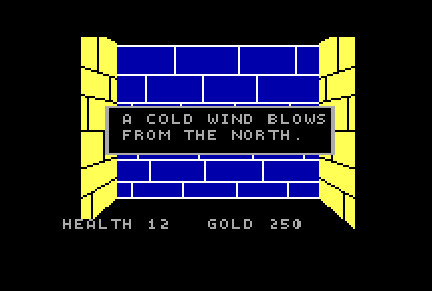
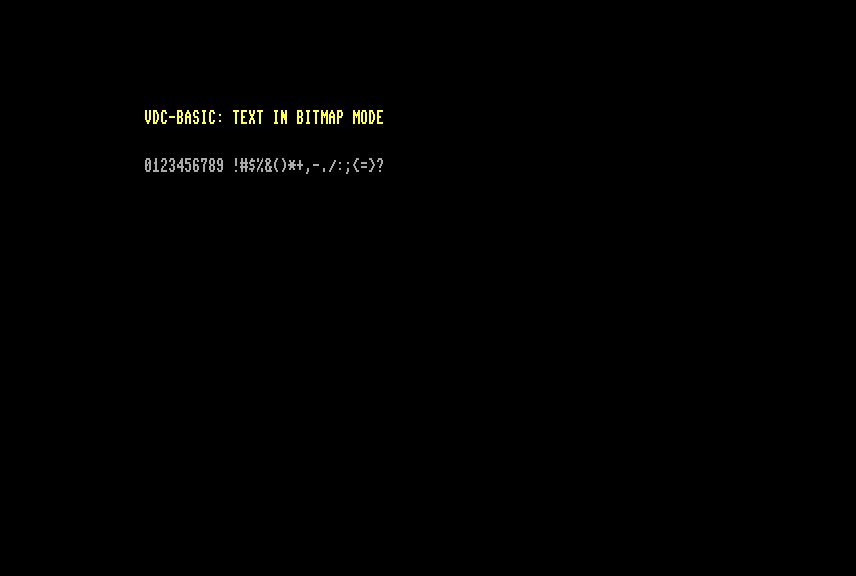

# 10. Words on a bitmap

In bitmap mode `PRINT` is of no use. It keeps writing character numbers to where the text screen used to be, and in our modes that produces stray pixels at best. Yet a game wants to show a score, and an adventure wants to talk.

By now we have all we need to do it ourselves. A letter is a small picture. A font is a sheet of small pictures, like the tile sheet. Printing a word is one blit per letter, each a little further to the right. VDC-BASIC has two commands that do exactly that, so that we do not have to take strings apart in BASIC.

## A font is a sheet

The font we use has letters of 6 × 6 pixels: 3 bytes wide, 6 rows high, 18 bytes per letter. There are 96 of them. They lie in VRAM one after the other, each one packed like a tile.

The order matters. The first picture is the space, and the rest follow in the order of their character codes: `!` is second, then `"`, and so on through the digits and the letters. In other words, the picture for the character with code *n* is number *n* − 32 on the sheet. That is the only rule a font has to obey. Codes below 32 have no picture and must not be printed.

A font is drawn as one picture in which the characters stand in a grid, 16 to a row for instance. The converter cuts the grid apart and stores the cells in order; you tell it the cell size. The file starts with three bytes: width in bytes, height in rows, number of characters.

## Setting up, then printing

```
VCS vaddr, width, height
```

tells VDC-BASIC where the font is and how large its characters are. It is given once and stays in force.

```
VMP vaddr, string
```

prints. The address is the place of the top left corner of the first character, calculated as for any blit. The string can be anything BASIC accepts as a string: text in quotes, a variable, an expression.

<!-- listing: 10-text.bas -->
```
10 REM WORDS ON A BITMAP: A FONT OF OUR OWN
20 IF PEEK(46)<>64 THEN PRINT "RUN"CHR$(34)"BOOT"CHR$(34)" FIRST":END
30 GOSUB 9000:P=16000
40 BF=DEC("8000"):FT=48000:REM THE FONT LIVES AT 48000 IN VRAM
50 BLOAD "DUNGEON",B0,P(BF):RTV BF+2,P,8000
60 BLOAD "FONT",B0,P(BF)
70 BANK 0:W=PEEK(BF):H=PEEK(BF+1):N=PEEK(BF+2):BANK 15
80 RTV BF+3,FT,W*H*N
90 VCS FT,W,H:REM GLYPHS ARE W BYTES WIDE AND H ROWS HIGH
100 G=250:VMP P+92*80+1,"HEALTH 12   GOLD"+STR$(G)
110 VMF P+36*80+12,DEC("EE"),57,24,80:REM A LIGHT GREY BOX ...
120 VMF P+37*80+13,0,55,22,80:REM ... WITH A BLACK INSIDE
130 VMP P+40*80+16,"A COLD WIND BLOWS"
140 VMP P+48*80+16,"FROM THE NORTH."
150 GETKEY K$
160 RST 3:PRINT CHR$(147):END
9000 REM --- 160 X 100 PIXELS, 16 COLOURS. NEEDS 64 KIB VRAM ---
9010 IF RGD(255)=0 THEN PRINT "THIS PROGRAM NEEDS 64 KIB VRAM":END
9020 RST 1:RGO 28,16
9030 T=(RGD(4)+1)*8+(RGD(5) AND 31):V=RGD(7)
9040 RGW 9,1:RGW 4,T/2-1:RGW 6,100:RGW 7,V*4
9050 VMF 0,15,16000:VMF 16000,0,8000
9060 DISP 0:ATTR 16000:RGO 25,128
9070 RETURN
```



Lines 60 to 80 load the font and put it at 48000 in VRAM, in the way we know from the tiles.

Line 90 declares it.

Line 100 prints a status line at row 92. Part of it is a number: `STR$(G)` turns the variable into text, with a space in front, as always.

Lines 110 and 120 draw a box with two filled rectangles, a grey one and a slightly smaller black one inside it. Lines 130 and 140 print into the box.

A few things to know:

- The characters are 3 bytes wide, so 26 of them fit on a row. `VMP` does not wrap and does not stop at the edge. A string that is too long continues in the next row, a few lines of pixels lower, on top of whatever is there.
- Every character is a blit, so it replaces its whole rectangle, background included. Text on a picture always stands on a patch of the font's background colour. That is why message boxes exist.
- The colours are in the font. For text in another colour, make a second sheet and switch with `VCS`.
- Letters in BASIC strings are capitals, with codes 65 to 90. Typed with SHIFT they have codes from 193 on and are outside of a 96-character font.
- An empty string prints nothing.

## Text from memory

`VMP` takes its text from a BASIC string. Its sibling takes it from RAM:

```
VMB vaddr, address, length
```

prints *length* characters that are stored at *address* in bank 0. This is for programs with a lot of text: room descriptions, dialogue, a level's messages. Such text can be loaded from disk as a file into a buffer and printed from there, without ever becoming BASIC strings and filling up the variable memory.

## Rows of a different length

When `VCS` is given, it looks up how many bytes the screen is wide and uses that as the step for the character blits. On our screen that is 80, and you need not think about it.

In the wide world of chapter 9 it would be wrong: there a row is 160 bytes long, although the screen still shows 80. For such cases `VCS` takes a fourth parameter, the row length:

```
VCS FT,W,H,160
```

## Text in the 640 × 200 mode

Everything above works in the high resolution mode too; there a character is typically 1 byte wide and 8 rows high. And there is a font in VRAM already that we can borrow: the VDC's own character set.

<!-- listing: 10-hires.bas -->
```
10 REM WORDS ON A BITMAP: THE BUILT-IN CHARACTERS IN 640 X 200
20 IF PEEK(46)<>64 THEN PRINT "RUN"CHR$(34)"BOOT"CHR$(34)" FIRST":END
30 IF RGD(255)=0 THEN PRINT "THIS PROGRAM NEEDS 64 KIB VRAM":END
40 RGO 28,16:RST 2:REM ALL 64 KIB, THEN A FRESH CHARACTER SET
50 FT=20000
60 VMC DEC("3000")+32*16,FT,96*16:REM RESCUE 96 CHARACTERS FROM THE BITMAP AREA
70 VMF 0,0,16000:VMF 16000,DEC("0E"),2000
80 DISP 0:ATTR 16000:RGO 25,128
90 VCS FT,1,16:REM ONE BYTE WIDE, 16 ROWS HIGH
100 VMP 16*80+4,"VDC-BASIC: TEXT IN BITMAP MODE"
110 VMP 40*80+4,"0123456789 !#$%&()*+,-./:;<=>?"
120 VMF 16000+80*2,DEC("0D"),80,2,80:REM THE FIRST LINE IN YELLOW
130 GETKEY K$
140 RST 3:PRINT CHR$(147)
```



In the character set every character has 16 bytes: 8 rows of pattern and 8 unused rows. We can declare that to `VCS` as a font 1 byte wide and 16 rows high (line 90). The unused rows come along and give us some space between the lines.

The second half of the character set, at `$3000`, has its characters in nearly the order `VMP` wants: capitals at 65 to 90, digits and punctuation at 32 to 63. So the font begins at character 32 of that set.

There is one obstacle. The bitmap occupies VRAM up to 15999 and will overwrite the character set, which lies at 8192 to 16383. Line 60 carries the 96 characters to safety first: one `VMC` to address 20000. (Line 40 reloads the character set right after switching on the 64 KiB, because that switch can leave what was in VRAM before in the wrong places.)

Line 120 colours the first line of text through the attributes, without touching the letters.

## What we have so far

| Command | Does |
|---|---|
| `VCS vaddr, width, height [, rowlength]` | declares a font |
| `VMP vaddr, string` | prints a string |
| `VMB vaddr, address, length` | prints text stored in RAM |

[Next: Sprites with holes](11-sprites-with-holes.md)
