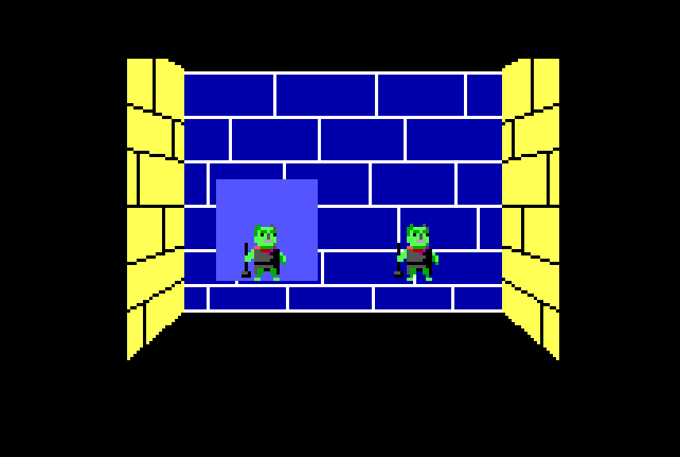
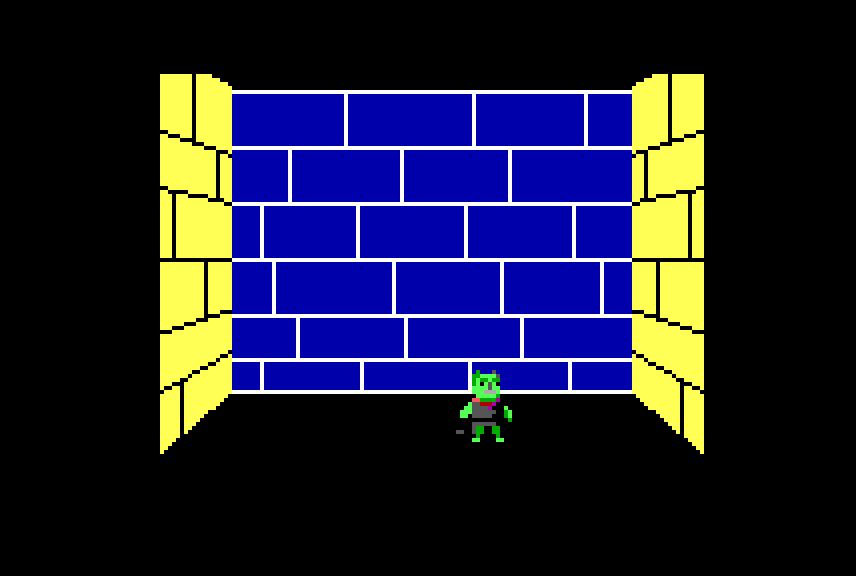

# 11. Sprites with holes

Time for a proper actor. The file `GOBPIC` holds a goblin, 32 × 32 pixels, drawn on a light blue background. We know how to put a picture on the screen:

```
VMC SH,P+40*80+20,16,32,80
```

The result is on the left of the picture below, and it is not what we want. The goblin has brought his light blue rectangle with him.



A blit replaces every byte of its rectangle. It has no notion of a pixel that should be left alone. And the VDC, unlike the VIC, has no sprites of its own that would float above the picture.

What we want is on the right: only the goblin's own pixels are drawn, and the wall shows through everywhere else. The figure has holes, and its outline is not a rectangle.

## Do the thinking in advance

How could a chip that only copies blocks of bytes draw a shape with an irregular outline?

Take one row of the goblin, somewhere in the middle. From left to right: a stretch of background, then a few bytes of goblin, perhaps a gap, a few more bytes of goblin, and background again. If we copy only the goblin stretches and skip the others, that row is drawn correctly. A row is a handful of short block copies. The whole figure is a few dozen.

Finding these stretches means looking at every pixel, which is hopeless at run time in BASIC. But it need not happen at run time. The shape of the goblin never changes. The stretches can be worked out once, on the PC, when the picture is converted, and stored as a list: *copy 3 bytes to position so-and-so, then 2 bytes to this position, ...*. At run time the list is simply played back.

That is what `VMS` does:

```
VMS source, target, list
```

*source* is the VRAM address of the sprite's pixel data. *target* is the place on the screen for its top left corner, a VRAM address like for a blit. *list* is the address of the list of stretches, which lies in the computer's RAM, in bank 0.

The converter produces both parts when you choose "Sprite with transparency" and tell it which colour is the background, and it puts them into one file:

| Bytes | Content |
|---|---|
| 2 | load address, ignored |
| 1, 1 | width in bytes, height in rows (for your information) |
| 2 | length of the list |
| 2 | length of the pixel data |
| | the list |
| | the pixel data |

Since the background is never copied, it is not stored either. The goblin's rectangle has 512 bytes; his pixel data has 87.

<!-- listing: 11-holes.bas -->
```
10 REM SPRITES WITH HOLES: THE SAME FIGURE AS A BLIT AND AS A SPRITE
20 BLOAD "VDCBASIC2H",B0:SYS DEC("1300")
30 GOSUB 9000:P=16000
40 BF=DEC("4000"):SH=40000:SP=42000
50 BLOAD "DUNGEON",B0,P(BF):RTV BF+2,P,8000
60 REM --- AS A PICTURE: 16 BYTES X 32 ROWS ---
70 BLOAD "GOBPIC",B0,P(BF):RTV BF+2,SH,512
80 VMC SH,P+40*80+20,16,32,80
90 REM --- AS A SPRITE: THE LIST STAYS IN RAM, THE DATA GOES TO VRAM ---
100 BLOAD "GOBLIN0",B0,P(BF)
110 BANK 0:LL=PEEK(BF+2)+256*PEEK(BF+3):DL=PEEK(BF+4)+256*PEEK(BF+5):BANK 15
120 RTV BF+6+LL,SP,DL
130 VMS SP,P+40*80+44,BF+6
140 GETKEY K$
150 RST 3:PRINT CHR$(147):END
9000 REM --- 160 X 100 PIXELS, 16 COLOURS. NEEDS 64 KIB VRAM ---
9010 IF RGD(255)=0 THEN PRINT "THIS PROGRAM NEEDS 64 KIB VRAM":END
9020 RST 1:RGO 28,16
9030 T=(RGD(4)+1)*8+(RGD(5) AND 31):V=RGD(7)
9040 RGW 9,1:RGW 4,T/2-1:RGW 6,100:RGW 7,V*4
9050 VMF 0,15,16000:VMF 16000,0,8000
9060 DISP 0:ATTR 16000:RGO 25,128
9070 RETURN
```

Lines 70 and 80 are the blit with the box, for comparison.

Line 100 loads the sprite file into the buffer. Line 110 reads the two lengths; each is stored in two bytes, low byte first. Line 120 sends the pixel data, which follows the list, to VRAM at `SP`. The list stays where it is, in the buffer: it starts at `BF+6`, after the six bytes of header.

Line 130 draws the sprite.

## The edge

There is a detail we have skipped. A byte holds two pixels. Along the outline of a figure there are bytes with one pixel of goblin and one of background. Copy such a byte, and a background pixel is drawn where none should be; skip it, and the goblin loses a pixel. Either way the outline would be ragged.

For these bytes the list has a second kind of entry. It tells `VMS` to fetch the byte from the screen, replace only one of its two pixels by the sprite's, and write it back. To know which pixel to keep, `VMS` looks at the sprite's byte: the pixel that has the *alpha colour* is the transparent one. The alpha colour is the background colour you named in the converter; it is stored at the beginning of the list.

So the sprite's outline is exact to the pixel, although the sprite as a whole can only be placed at even columns. If a figure must stand at an odd column, convert a second version of it, drawn one pixel further to the right in its rectangle.

Mixed bytes are slower than copied stretches, because each of them travels to the CPU and back. A goblin costs a little over half as much time again as a plain blit of his rectangle. A sprite with a smooth outline and a solid body is cheap; a cloud of single pixels is expensive.

The exact layout of the list, with an example small enough to follow byte by byte, is in the reference: [VMS list format](reference/vms-format.md). You do not need it to use sprites, but it is not complicated, and a program can build such lists itself.

## Walking

A sprite is drawn into the picture like everything else; it does not float. To move it, the background has to be restored where it was, and we already have the pattern for that from chapter 8: every frame starts from the clean background on the hidden page.

<!-- listing: 11-walk.bas -->
```
10 REM SPRITES WITH HOLES: A FIGURE THAT WALKS. KEYS I J K L, X TO END
20 BLOAD "VDCBASIC2H",B0:SYS DEC("1300")
30 GOSUB 9000:PG(0)=16000:PG(1)=24000
40 BF=DEC("4000"):BG=32000
50 BLOAD "DUNGEON",B0,P(BF):RTV BF+2,BG,8000
60 REM TWO SPRITES: LISTS AT L(0), L(1) IN RAM, DATA AT S(0), S(1) IN VRAM
70 A=DEC("5000"):VA=40000
80 FOR I=0 TO 1
90 : BLOAD ("GOBLIN"+CHR$(48+I)),B0,P(A)
100 : BANK 0:LL=PEEK(A+2)+256*PEEK(A+3):DL=PEEK(A+4)+256*PEEK(A+5):BANK 15
110 : L(I)=A+6:S(I)=VA:RTV A+6+LL,VA,DL
120 : A=A+6+LL:VA=VA+DL:REM THE NEXT FILE OVERWRITES THE DATA, NOT THE LIST
130 NEXT
140 X=32:Y=60:F=0:V=0
150 DO
160 : D=PG(1-V):VMC BG,D,8000
170 : VMS S(F),D+Y*80+X,L(F)
180 : SYN:ATTR D:V=1-V
190 : GETKEY K$
200 : IF K$="J" AND X>0 THEN X=X-1
210 : IF K$="L" AND X<64 THEN X=X+1
220 : IF K$="I" AND Y>1 THEN Y=Y-2
230 : IF K$="K" AND Y<66 THEN Y=Y+2
240 : F=1-F:REM THE OTHER PICTURE FOR THE NEXT STEP
250 LOOP UNTIL K$="X"
260 RST 3:PRINT CHR$(147):END
9000 REM --- 160 X 100 PIXELS, 16 COLOURS. NEEDS 64 KIB VRAM ---
9010 IF RGD(255)=0 THEN PRINT "THIS PROGRAM NEEDS 64 KIB VRAM":END
9020 RST 1:RGO 28,16
9030 T=(RGD(4)+1)*8+(RGD(5) AND 31):V=RGD(7)
9040 RGW 9,1:RGW 4,T/2-1:RGW 6,100:RGW 7,V*4
9050 VMF 0,15,16000:VMF 16000,0,8000
9060 DISP 0:ATTR 16000:RGO 25,128
9070 RETURN
```



The goblin walks with the keys I, J, K and L. X ends the program.

Lines 80 to 130 load two sprites, two phases of a walking movement. They share the buffer in a thrifty way. The first file is loaded at `A`. Its list must stay in RAM, but its pixel data has gone to VRAM and is no longer needed. So the next file is loaded where that pixel data begins (line 120), and overwrites it. The lists end up one after the other, and their addresses are kept in `L(0)` and `L(1)`. The pixel data goes to VRAM one after the other as well, with the addresses in `S(0)` and `S(1)`.

Lines 160 to 180 are the pattern from chapter 8, with the sprite as the thing that is drawn: clean background onto the hidden page, sprite on top, flip.

Lines 200 to 230 move the position, and line 240 switches to the other picture, so that the goblin moves his legs with every step.

The limits in lines 200 to 230 keep him on the screen. `VMS` checks as little as `VMC` does.

Several sprites are simply several `VMS` statements before the flip. They are drawn in the order of the statements, later ones on top; to make a figure walk behind another, draw it first.

## Without a second page

Copying the whole background for every frame is simple and fast. If memory is short, there are thriftier ways to get the background back:

- Restore only the rectangle the sprite stood on, from the clean copy: `VMC BG+Y*80+X,D+Y*80+X,16,32,80,80`. With two pages, remember that the hidden page still shows the position of two steps ago.
- Without a clean copy: before drawing the sprite, save the rectangle it will cover into a free corner of VRAM, and put it back before the next step. Saving is a blit in the other direction: the source is on the screen and steps by 80, the saved piece is packed and steps by its own width.

```
VMC D+Y*80+X,SV,16,32,16,80 : REM save: 16 bytes per row, packed at SV
VMS SP,D+Y*80+X,L           : REM draw
...
VMC SV,D+Y*80+X,16,32,80    : REM put the background back
```

## What we have so far

| Command | Does |
|---|---|
| `VMS source, target, list` | draws a picture with transparent parts |

[Next: Scripts for the chip](12-scripts-for-the-chip.md)
