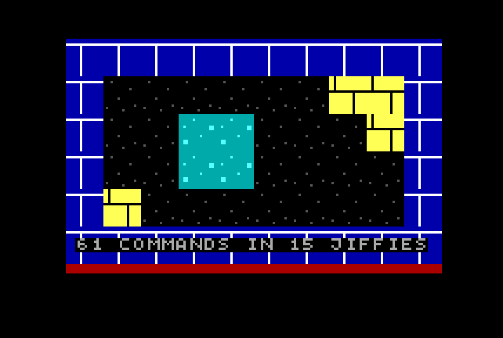

# 12. Scripts for the chip

The room of chapter 7 took a little over two seconds to appear: sixty blits, each of which the VDC finishes in a blink. We have met this pattern in every chapter. The chip is fast and BASIC is not, and whatever keeps BASIC out of the way makes a program faster. `VMF` replaced a loop of 2000 statements. The long form of `VMC` replaced a loop of 32. Now we replace the sixty.

What does BASIC do sixty times? It reads the statement, looks up `SH`, `T`, `P`, `R` and `C`, multiplies and adds in floating point, and converts five results into whole numbers. Only then does `VMC` get its five numbers. All this effort produces the same five numbers every time the room is drawn, as long as the map does not change.

So let us work them out once and keep them.

## A list of commands

```
VCL address
```

"VDC command list". At the given address in RAM, bank 0, lies a list of entries. Each entry stands for one VDC-BASIC command: a byte that says which command, followed by the parameters as plain numbers, two bytes each, low byte first. A zero byte ends the list. `VCL` runs through it in machine language and performs one command after the other.

The most useful entries:

| Type byte | Parameters (two bytes each) | Same as |
|---|---|---|
| 1 | source, target, count | `VMC` with three parameters |
| 2 | source, target, count, repetitions, target step | `VMC` with five: the blit |
| 3 | source, target, count, repetitions, target step, source step | `VMC` with six |
| 4 | address, value, count | `VMF` with three |
| 5 | address, value, count, repetitions, step | `VMF` with five: the rectangle |
| 6 | address, value | `VMW` |
| 12 | source, target, list | `VMS`: a sprite |
| 13 | n, then n pairs register, value | `SYN`: wait, then write the registers (n = 0: only wait) |
| 0 | | end of the list |

The complete table is in the reference: [VCL list format](reference/vcl-format.md).

A blit of a tile, `VMC 40128,16008,8,16,80`, becomes these eleven bytes:

```
2,  192,156,  136,62,  8,0,  16,0,  80,0
```

2 is the type. 40128 is 156 × 256 + 192, so its two bytes are 192 and 156, and so on.

## Writing the list

A list can be typed in as `DATA`, calculated by a tool on the PC, or written by the program itself. The last way is the most convenient: the program still contains the map in a readable form, and a loop turns it into a list.

<!-- listing: 12-list.bas -->
```
10 REM SCRIPTS FOR THE CHIP: THE ROOM OF CHAPTER 7 AS A COMMAND LIST
20 BLOAD "VDCBASIC2H",B0:SYS DEC("1300")
30 GOSUB 9000:P=16000
40 BF=DEC("4000"):SH=40000:FT=48000
50 BLOAD "TILES",B0,P(BF):RTV BF+2,SH,1024
60 BLOAD "FONT",B0,P(BF):RTV BF+3,FT,1728:VCS FT,3,6
70 VMP P+45*80+20,"WRITING THE LIST"
80 L=DEC("5000"):A=L:BANK 0:REM THE LIST STARTS AT L IN RAM
90 FOR R=0 TO 5:READ M$
100 : FOR C=0 TO 9:T=VAL(MID$(M$,C+1,1))
110 : POKE A,2:A=A+1:REM ENTRY TYPE 2: A BLIT WITH FIVE PARAMETERS
120 : W=SH+T*128:GOSUB 500:REM SOURCE
130 : W=P+R*16*80+C*8:GOSUB 500:REM TARGET
140 : W=8:GOSUB 500:W=16:GOSUB 500:W=80:GOSUB 500
150 : NEXT
160 NEXT
170 POKE A,5:A=A+1:REM ENTRY TYPE 5: A FILLED RECTANGLE
180 W=P+96*80:GOSUB 500:W=DEC("88"):GOSUB 500
190 W=80:GOSUB 500:W=4:GOSUB 500:W=80:GOSUB 500
200 POKE A,0:BANK 15:REM A ZERO ENDS THE LIST
210 T=TI:VCL L:T=TI-T
220 VMP P+85*80+2,"61 COMMANDS IN"+STR$(T)+" JIFFIES"
230 GETKEY K$
240 RST 3:PRINT CHR$(147):END
300 DATA "1111111111"
310 DATA "1000000221"
320 DATA "1007700021"
330 DATA "1007700001"
340 DATA "1200000001"
350 DATA "1111111111"
500 REM --- PUT THE NUMBER W INTO THE LIST AS TWO BYTES ---
510 H=INT(W/256):POKE A,W-256*H:POKE A+1,H:A=A+2:RETURN
9000 REM --- 160 X 100 PIXELS, 16 COLOURS. NEEDS 64 KIB VRAM ---
9010 IF RGD(255)=0 THEN PRINT "THIS PROGRAM NEEDS 64 KIB VRAM":END
9020 RST 1:RGO 28,16
9030 T=(RGD(4)+1)*8+(RGD(5) AND 31):V=RGD(7)
9040 RGW 9,1:RGW 4,T/2-1:RGW 6,100:RGW 7,V*4
9050 VMF 0,15,16000:VMF 16000,0,8000
9060 DISP 0:ATTR 16000:RGO 25,128
9070 RETURN
```



Lines 90 to 160 are the loop of chapter 7, but where that one had a `VMC`, this one writes an entry into the list. `A` is the address of the next free byte. Line 110 pokes the type. Lines 120 to 140 hand each parameter to the little subroutine at line 500, which splits a number into its two bytes and pokes them.

Lines 170 to 190 add the red bar, an entry of type 5.

Line 200 closes the list with a zero.

Writing the list is slow, slower than drawing the room directly was. That is the investment.

Line 210 is the return on it. The room appears as if it had always been there. Line 220 prints how long it took: 14 jiffies for 61 commands, against 133 jiffies for the 60 blits in chapter 7. And nearly all of those 14 belong to the VDC now.

## Lists are data

Once a screen is a list, new things become easy.

**Save it.** A list is a block of memory. `BSAVE "ROOM",B0,P(L) TO P(A+1)` writes it to disk, and the next time the program loads it instead of building it. Levels can be files.

**Keep several.** One list per room, per menu, per kind of wall. Showing something is one `VCL` with the right address. The view of a first-person dungeon game is a natural case: each wall piece at each distance is a few blits, and what is visible from where the player stands decides which lists are run, back to front.

**Mix commands.** A list can clear a page, lay the tiles, draw the frame around the status display and place three sprites, in one go. A `SYN` entry (type 13) can stand anywhere in the list, as often as needed: it waits for the vertical blank and can set registers there, for example to show a page or to change the colours from that point on.

**Change one number.** The entries are at known places in memory. Poke a different source address into the third tile's entry, and that tile is a different one the next time the list runs. A tile that is animated, a door that opens.

Two things a list cannot do. It cannot decide anything: there is no "if". And every address in it is fixed when it is written. A list that draws onto page 0 always draws onto page 0. To use lists with page flipping, write one list per page, which can also show its page with a type 13 entry that writes R12 and R13, or let the list draw into a store from which the pages are refreshed, as in chapter 8.

## Fine print

- The list must be in bank 0. It can be anywhere there except `$D000`–`$DFFF`, and as long as you like.
- In the list every parameter is two bytes, also those that are a single byte in BASIC.
- Negative steps are written as 65536 minus the amount: −80 is 65456, the bytes 176 and 255.
- A type byte that `VCL` does not know stops the list with the message `INVALID`.

## What we have so far

| Command | Does |
|---|---|
| `VCL address` | runs a list of copy, fill, write, sprite and `SYN` commands |

That was the last command. You have now met all of VDC-BASIC. The remaining chapters put the pieces together.

[Next: Speed, memory and other limits](13-speed-and-limits.md)
