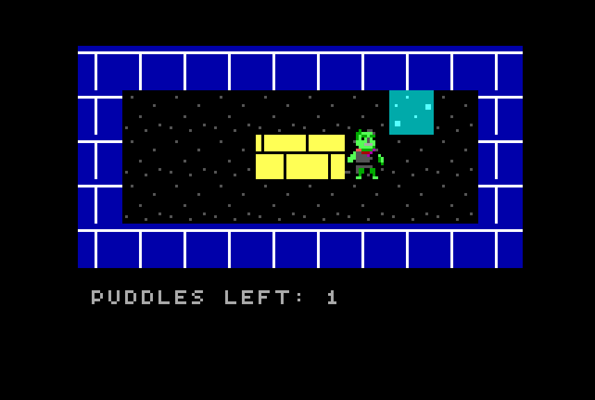
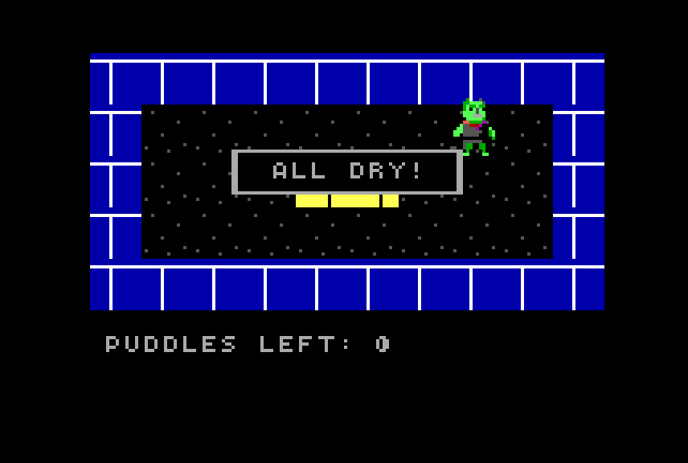

# 14. The room

This chapter adds nothing new. It takes the pieces of the last ten chapters and makes a small game of them, to show how they fit.

A goblin with a mop lives in a room. There are puddles on the floor. Walk him over them with the keys I, J, K and L until the room is dry.



Small as it is, it has what most games have: a world made of tiles, a figure that moves through it and is stopped by walls, things that disappear when they are touched, a display that keeps count, and an end.

## The plan

First the memory, as chapter 13 recommends.

| VRAM | Content | Name in the program |
|---|---|---|
| 0–15999 | bitmap | |
| 16000 | page 0 | `PG(0)` |
| 24000 | page 1 | `PG(1)` |
| 32000 | the room without the goblin: the store | `BG` |
| 40000 | tiles | `SH` |
| 42000 | pixel data of the two goblin sprites | `S(0)`, `S(1)` |
| 48000 | font | `FT` |

| RAM, bank 0 | Content | Name |
|---|---|---|
| `$4001`- | the BASIC program | |
| `$8000` | buffer for loading | `BF` |
| `$A000` | the command list that draws the room | `RL` |
| `$A800` | the lists of the two sprites | `L(0)`, `L(1)` |

The idea that holds it together is the store at `BG`. It always contains the room as it currently is, with its remaining puddles and its status line, and without the goblin. Every frame is made in the same way: copy the store to the hidden page, draw the goblin on top, flip. Whatever changes in the room is changed in the store, once, and is on the screen from the next frame on.

## The program

<!-- listing: 14-room.bas -->
```
10 REM THE ROOM: A GOBLIN MOPS UP PUDDLES. KEYS I J K L, X TO END
20 IF PEEK(46)<>64 THEN PRINT "RUN"CHR$(34)"BOOT"CHR$(34)" FIRST":END
30 GOSUB 9000:PG(0)=16000:PG(1)=24000:BG=32000
40 BF=DEC("8000"):SH=40000:FT=48000
50 BLOAD "FONT",B0,P(BF):RTV BF+3,FT,1728:VCS FT,3,6
60 VMP PG(0)+45*80+22,"ONE MOMENT..."
70 BLOAD "TILES",B0,P(BF):RTV BF+2,SH,1024
80 GOSUB 1000:REM LOAD THE SPRITES
90 GOSUB 2000:REM READ THE MAP, WRITE THE COMMAND LIST
100 VMF BG,0,8000:VCL RL:REM THE ROOM, DRAWN INTO THE STORE
110 GX=1:GY=1:F=0:V=0:GOSUB 3000
120 DO
130 : D=PG(1-V):VMC BG,D,8000
140 : VMS S(F),D+(GY*16-16)*80+GX*8-4,L(F)
150 : SYN:ATTR D:V=1-V
160 : IF N=0 THEN EXIT
170 : GETKEY K$
180 : NX=GX:NY=GY
190 : IF K$="J" THEN NX=GX-1
200 : IF K$="L" THEN NX=GX+1
210 : IF K$="I" THEN NY=GY-1
220 : IF K$="K" THEN NY=GY+1
230 : T=M(NX,NY):IF T=1 OR T=2 THEN 260:REM A WALL: STAY
240 : GX=NX:GY=NY:F=1-F
250 : IF T=7 THEN GOSUB 4000:REM A PUDDLE: MOP IT UP
260 LOOP UNTIL K$="X"
270 IF N>0 THEN 310
280 VMF D+30*80+22,DEC("EE"),36,14,80:VMF D+31*80+23,0,34,12,80
290 VMP D+34*80+28,"ALL DRY!"
300 GETKEY K$
310 RST 3:PRINT CHR$(147):END
400 DATA "1111111111"
410 DATA "1007000701"
420 DATA "1000220001"
430 DATA "1070007001"
440 DATA "1111111111"
1000 REM --- TWO SPRITES: LISTS AT L(0), L(1) IN RAM, DATA AT S(0), S(1) IN VRAM ---
1010 A=DEC("A800"):VA=42000
1020 FOR I=0 TO 1
1030 : BLOAD ("GOBLIN"+CHR$(48+I)),B0,P(A)
1040 : BANK 0:LL=PEEK(A+2)+256*PEEK(A+3):DL=PEEK(A+4)+256*PEEK(A+5):BANK 15
1050 : L(I)=A+6:S(I)=VA:RTV A+6+LL,VA,DL
1060 : A=A+6+LL:VA=VA+DL
1070 NEXT:RETURN
2000 REM --- READ THE MAP INTO M(), WRITE THE COMMAND LIST FOR THE ROOM ---
2010 RL=DEC("A000"):A=RL:N=0:BANK 0
2020 FOR R=0 TO 4:READ M$
2030 : FOR C=0 TO 9:T=VAL(MID$(M$,C+1,1)):M(C,R)=T:IF T=7 THEN N=N+1
2040 : POKE A,2:A=A+1
2050 : W=SH+T*128:GOSUB 2500:W=BG+R*16*80+C*8:GOSUB 2500
2060 : W=8:GOSUB 2500:W=16:GOSUB 2500:W=80:GOSUB 2500
2070 : NEXT
2080 NEXT:POKE A,0:BANK 15:RETURN
2500 H=INT(W/256):POKE A,W-256*H:POKE A+1,H:A=A+2:RETURN
3000 REM --- THE STATUS LINE, WRITTEN INTO THE STORE ---
3010 VMP BG+88*80+2,"PUDDLES LEFT:"+STR$(N):RETURN
4000 REM --- MOP UP THE PUDDLE AT GX,GY ---
4010 M(GX,GY)=0:N=N-1
4020 VMC SH,BG+GY*16*80+GX*8,8,16,80:REM A FLOOR TILE INTO THE STORE
4030 GOSUB 3000:RETURN
9000 REM --- 160 X 100 PIXELS, 16 COLOURS. NEEDS 64 KIB VRAM ---
9010 IF RGD(255)=0 THEN PRINT "THIS PROGRAM NEEDS 64 KIB VRAM":END
9020 RST 1:RGO 28,16
9030 T=(RGD(4)+1)*8+(RGD(5) AND 31):V=RGD(7)
9040 RGW 9,1:RGW 4,T/2-1:RGW 6,100:RGW 7,V*4
9050 VMF 0,15,16000:VMF 16000,0,8000
9060 DISP 0:ATTR 16000:RGO 25,128
9070 RETURN
```

### Getting ready: lines 20 to 110

Line 20 checks that `BOOT` has installed VDC-BASIC. Line 30 switches to the 160 × 100 mode (the subroutine at 9000, unchanged since chapter 5) and names the two pages and the store.

Lines 50 and 60 load the font first and use it at once to print a message on the visible page, because the rest of the preparation takes a few seconds.

Line 70 loads the tiles. Line 80 calls the sprite loader, which is the loop from chapter 11 moved into a subroutine at line 1000.

Line 90 calls the subroutine at 2000. It reads the map from the `DATA` lines and does two things with each tile. It notes it in the array `M()`, which the game will consult later to know what lies where; puddles are counted in `N` along the way. And it writes a blit for it into the command list at `RL`, as in chapter 12. Note the target in line 2050: the list draws into the store, not onto a page.

Line 100 clears the store and runs the list. The room now exists, unseen.

Line 110 puts the goblin on the tile at column 1, row 1, and has the status line written.

### The frame: lines 130 to 150

Three statements, the same three as in chapter 11.

`VMC BG,D,8000` brings the room to the hidden page.

`VMS` draws the goblin. His position is kept in tiles, `GX` and `GY`. The sprite is 32 × 32 pixels and the goblin stands in the lower middle of it, so the sprite is placed 16 rows higher and 4 bytes further left than the tile he stands on: row `GY*16-16`, byte `GX*8-4`. Because the outer tiles of the map are walls, he can never stand in column 0 or row 0, and these numbers cannot become negative.

`SYN:ATTR D:V=1-V` shows the page.

### The move: lines 170 to 250

The program waits for a key and works out the tile the goblin would step onto, `NX`, `NY`. Line 230 looks into the map. If there is a wall (tile 1 or 2), nothing happens. Otherwise he moves there, and `F` switches to the other sprite so that his legs move.

If the tile was a puddle, the subroutine at 4000 mops it up. It clears the tile in the map, counts down, and repairs the store: one blit puts a floor tile where the puddle was. Then it has the status line rewritten. Both changes are made in the store, so they survive every later frame without further effort.

The status line is the subroutine at 3000: one `VMP` into the store.

### The end: lines 160 and 270 to 310

When the last puddle is gone, line 160 leaves the loop after the frame that shows it. Lines 280 and 290 draw a box and a message straight onto the visible page, which is `D` at that moment. A key, and `RST 3` gives the text screen back.



## What the chip did

It is worth going through one step of the goblin and counting. BASIC executes about a dozen statements. The VDC, meanwhile, moves 8000 bytes for the room, plays back a sprite list of some 49 entries, and switches pages; when a puddle is mopped up, another blit and a line of text. That is roughly 8300 bytes changed for one step, all of them by block operations inside the chip, and none by a `POKE`.

That has been the method of the whole book: arrange VRAM so that every change you need is a copy, and let the chip copy.

## Where to go from here

Some things to try with this program, roughly in order of effort:

- Draw your own tiles, sprites and font and run them through the converter. The program does not care what the pictures show.
- Make the map larger than the screen and scroll it (chapter 9). Remember the row length.
- Let the water move: tiles 3 to 6 are four phases of a water surface. Poke a different source address into the list entries of the water tiles and run the list again (chapter 12).
- Add a second figure that moves by itself. It is one more `VMS` per frame.
- Save the room list to disk and load rooms as files.
- Put `FAST` in a line 25 and `SLOW` before the program ends.

The graphics in this book come from a larger program built with the same commands: a first-person dungeon crawler written for the Dungeon Crawler Jam 2025, in the repository `dungeoncrawlerjam2025`. Its view is put together from wall pieces that are blitted from sheets with `VMC`, and all its text is printed with `VMP`. After this chapter you will be able to read it.

Everything about every command, in one place: the [command reference](reference/commands.md).
