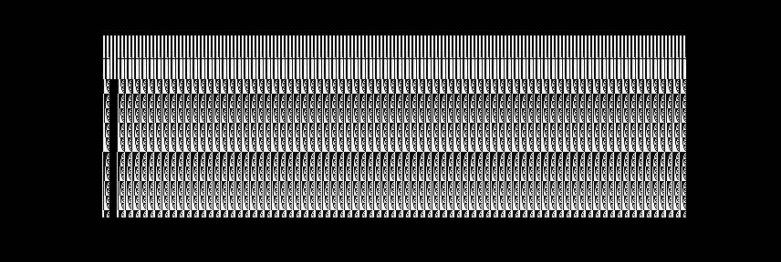
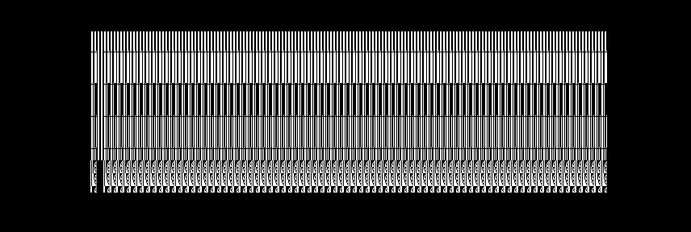
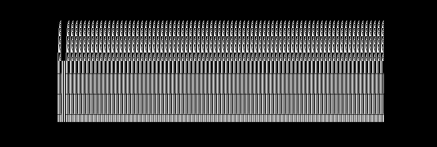
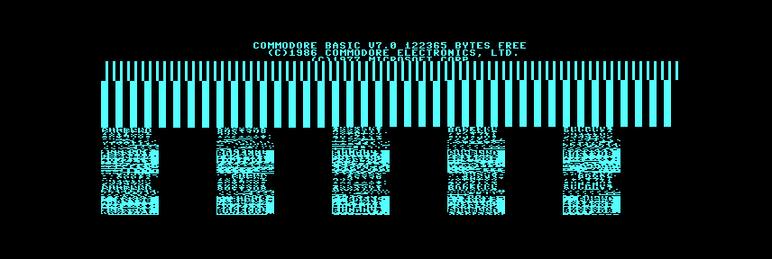
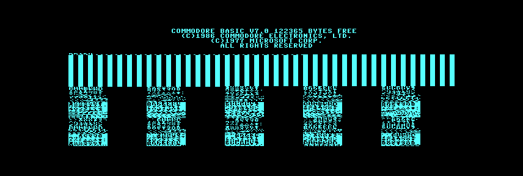
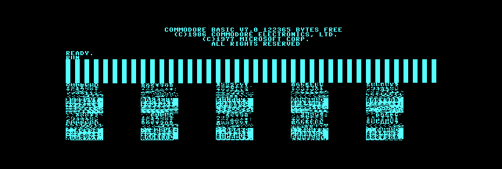

# Deferred: VRS – raster split (text and bitmap mixed on one screen)

As of: 2026-11-27. **Status: deferred, analysis only.** Nothing implemented, no prototype measured on the target IRQ design. Resume with prototype P0a (below) when a game or demo needs a mixed text/bitmap screen (like BASIC 7 `GRAPHIC 2` on the VIC-II).

Goal: a keyword `VRS` that shows bitmap and text mode on one VDC screen, switched mid-frame by a raster split. Analysis done read-only by an Opus subagent on `vdcsplit/vdcsplit.asm`, the VDC-BASIC sources and the KERNAL ROM. **Numbers marked (e) are estimates, not measurements.**

## Verdict

Feasible in principle as an IRQ solution on CIA1 timer B, but with hard preconditions and open hardware questions. Do not implement directly: build the prototype first and decide on the measured result (AGENTS.md rule).

## How `vdcsplit` does it

- Foreground program with `SEI`, VIC blanked (`$D011` bit 4 = 0, no bad lines), implicitly 1 MHz. 100 % CPU, not usable as a background command.
- Only timing source is VDC status bit 5 (`$D600`, border/vblank). No VIC raster IRQ, no CIA timer.
- Sequence: wait bit 5 = 1 → write `prevalue`; wait bit 5 = 0 (first display line); trigger the light pen latch via CIA1 port B (`$00`, `$FF`); read R17 (LP horizontal) to measure the jitter; `temp = (70 − LPx)/2` (1 CPU cycle = 2 VDC character clocks at 1 MHz, 70 is empirical); cancel the jitter with a clockslide (254 × `CMP #`, `JSR clockslide+(255−x)` = 14+x cycles); then wait the split delay (`testbitdelay` 0–255 cycles + `delay256` × 256 cycles) and write `postvalue`.
- Switches only R25 (bit 7 bitmap, bit 6 attributes) and R26 (colours). R12/13, R20/21, R4/6/7, R9, R28 untouched.
- Limits: `delay256` is capped at 0..13 (≈ 3600 cycles ≈ 56 lines), so only the top ≈ 7 text rows are reachable. Fixed 1 MHz. PAL/NTSC differ by about one line. No ready-bit wait before the `$D601` writes. R25 is not restored on exit.
- hblank window: (R0+1 − R1) = 127 − 80 = 47 characters ≈ 23.5 µs ≈ 23 cycles at 1 MHz, 47 at 2 MHz.

## Proposed design

- **Timing:** a VIC raster IRQ does not work: VDC frame (PAL 312 × 63.5 µs ≈ 19 520 cycles) and VIC frame (19 656) drift by ≈ 136 cycles per frame. Use **CIA1 timer B, continuous, alternating latch values** with a software PLL. Two IRQs per VDC frame:
  - **V** shortly before display start: sync to the falling edge of status bit 5, measure the phase error, correct the next latch value.
  - **S** writes R25 in the hblank of the line before the split.
  - Calibrate the period when enabling (measure two bit 5 edges); this makes SLOW/FAST and PAL/NTSC transparent (CIAs run at 1 MHz in FAST).
- **Cost (e):** ≈ 350–450 cycles per frame ≈ 2 % at 1 MHz, ≈ 1 % at 2 MHz.
- **Syntax proposal:** `VRS row [,top,bottom [,reg,top2,bottom2]]`, `VRS 0` = off. `row` = 1..R6−1, text row where the lower part starts (raster line = row·(R9+1)). Default without values like `GRAPHIC 2`: top = current R25 with bit 7 = 1, bottom bit 7 = 0. Only one register is safe in the hblank at 1 MHz; two preloaded writes without ready wait ≈ 16 cycles.
- **Implementation sketch:**
  - Token `$FE $43` "vrS" after "vdM" in `instruction_strings`/`instruction_ptrs` (`src/vdcbasic.asm:244–263`), assertion like `.vdm_entry` (:269–276); also update `BASIC V7.0 VDC.txt` and `test/bastok.py`.
  - Parser like `.syn_with_args` (:359–380): `b_parse_uint8_to_X`, `chrgot`, `b_skip_comma`; range error → `?ILLEGAL QUANTITY`.
  - Enable: `SEI`, save and redirect `$0314`, read R9/R4/R5, calibrate, start TB with latch chain L1 (display start → split − guard) and L2 (rest − poll window), ICR `$82`, `CLI`.
  - `vrs_irq`: read `$DC0D` (not TB → watchdog count, `JMP (old_0314)`); phase V/S as above; restore `$D600` from shadow or PC-window table at the end; without raster source jump directly to `$FF33`.
  - Disable: `SEI`, ICR `$02`, stop TB, restore vector and R25. Same in `RST` and `SYS 7168`.
- **Memory:** C128 RAM ≈ 0.6–0.9 KB (e) of the free 4374 bytes (`$2EEA–$3FFF`) plus ≈ 28 × 3 bytes for the shadow protocol; must stay below `$4000` (`vdclib_assert_below_basic_rom`). VRAM: editor bases `$0A2E`/`$0A2F` must be 2K-aligned, charset base R28 8K-aligned.
  - Text on top (k rows), bitmap below: bitmap starts at E + 80k with continuous counting, at E + 640k in VICE (560k bytes wasted).
  - Bitmap on top, text below: only with continuous counting; B = E − 560k (wraps at 16K/64K).
  - 16K VRAM is tight: with one 4K charset plus attributes ≈ 14 bitmap rows max, without attributes ≈ 18, with the full 8K charset ≈ 7. A `GRAPHIC 2` equivalent (20 rows) needs 64K.
- **Existing commands:** `VDL`/`VDR`/`VDB` work unchanged (`VDM 0,<first bitmap row>,80`, state `draw_base`/`draw_stride`, `vdcbasic.asm:2864–2865`). `VMC`/`VMF`/`RXV`/`VMS`/`VCL`/`VMP`/`VMB` use absolute VRAM addresses. `PRINT`/editor need `WINDOW` on the text rows and a matching `$0A2E`. Optional: VRS sets `draw_base`, or a pseudo register function (e.g. `RGD(253)`) returns the bitmap base.

## Risks and open questions

1. **Register select race (critical).** `$D600` cannot be read back (reads status). An IRQ writing VDC registers destroys running VDC-BASIC/KERNAL/BASIC accesses; the project convention forbids IRQ access to the VDC so far (`docs/reference/commands.md:21`, `docs/v3/P2b-rxv.md:153`).
   - VDC-BASIC: shadow byte, `stx shadow` before every `stx vdc_reg`, IRQ restores `$D600 = shadow`. ≈ 28 places: `vdclib.a:85,102,124` plus ≈ 25 in `vdcbasic.asm` (618–642, 959, 1021–1071, 1119, 1627/1631, 2267–2290, 2392, 2408, 2460, 2659, 2815). +4 cycles per select (+3 in zero page). VMC row ≈ 8 % slower (e), `pix_rmw` 10–15 % (e) – **must be measured**.
   - KERNAL: all editor accesses go through `$CDCC` (write) and `$CDDA` (read); init `$E1E4`, `$FC6B`. IRQ checks the stacked PC (stack from `$FF17`: MMU, Y, X, A, P, PC); inside `$CDCF–$CDD7` or `$CDDD–$CDE5` restore `$D600` from the stacked X. BASIC ROM: `COLOR` read-modify-write R26 at `$6A32–$6A40`, `RCLR` `$81DE`, `PEN` `$82E4` – same window table.
   - Own ML routines must follow the shadow protocol; proposal: reserved header byte `$1C05` as documented shadow address.
2. **Address model at a mid-frame mode change is unknown on real hardware.** VICE keeps text and bitmap address counters separate and "absolute" (measured, see below); real hardware presumably counts on continuously. Not proven; this is the most important prototype question. If real hardware differs from VICE, VICE is unusable for image tests (and would be a VICE bug).
3. **Register writes while the VDC is busy** (block fill/copy from VMC, VMF, RXV, VDB): does an R25 write arrive without the ready bit? Does R25 take effect mid-line or at line/character-row start? Mitigation: S-IRQ with guard time (e.g. 4 lines early) and ready wait; if the fill is too long there is a glitch. Z64K requires ready before every `$D601` access.
4. R12/13 and R20/21 are probably only latched at frame start, not effective mid-frame (presumption).
5. **KERNAL IRQ/CIA:** KERNAL IRQ `$FA65` acknowledges `$DC0D` only on the raster path, so the own handler on `$0314` must read `$DC0D` and handle TB itself. Fast-serial setup (`$E5D6–$E5E0`) and IOINIT (`$E109`) write `$7F` to `$DC0D` and clear the TB mask → watchdog in the raster path (no V IRQ for n jiffies → set mask, resync). Serial routines do `SEI` (`$E573`, from `$E43E`): wrong-mode frames during LOAD/SAVE. Tape redirects vector and timer, VRS is dead until the watchdog resyncs. RUN/STOP-RESTORE: does the NMI path write ICR `$7F`? Untested. KERNAL init sets TB free-running `$FFFF` (`$E1C1–$E1CB`); no other TB user besides tape found. Editor IRQ does `CLI` at `$C229`, so TB can interrupt it; editor IRQ does not touch the VDC in 80-column mode (`$C6E7`). That the BASIC interrupt (`$4006`) does not touch the VDC is presumed, not disassembled.
6. **Bad lines/sprites** (1 MHz, VIC on): up to ≈ 43 cycles delay, exceeding the 23-cycle window; ≈ 5 % of frames would get a disturbed line (e). So VRS blanks the VIC like `vdcsplit` or requires FAST. Whether sprite DMA runs with DEN = 0 is open.
7. **Conflicts:** `RST` must switch VRS off first; `RGW 25`/`RGO 25` and `SYN 25,…` are overwritten at the next V; `DISP`/`ATTR` page flip carries the bitmap part along. Blitz: handler must be visible at `$FF00 = 0` (RAM 0 `$1C10–$3FFF` fits, also with VCL 9 and 16K common, `docs/v3/P2d-vms-bank1.md:47`); whether the Blitz runtime redirects `$0314` is open.
8. Jitter budget at 1 MHz (window ≈ 23 cycles): poll granularity of the bit 5 loop ≈ 9 cycles, timer compare loop ≈ 9 cycles – tight. The LP correction of `vdcsplit` is the reserve but destroys `PEN()`, triggers the VIC LP latch and needs exact save/restore of CIA1 ports.
9. Chunky mode (R9 = 1) mixed with text (R9 = 7) would need an extra R9 write mid-frame; highly speculative.

## Fallbacks without IRQ

- Whole screen bitmap, text via `VCS`/`VMP`/`VMB` (exist already).
- Graphics window inside text mode via a redefined charset (max 512 characters).

## Prototype plan (measure first)

- **P0a, VICE, ≈ 2 h (e), core measurement fits the 15–20 min time box:** stand-alone ca65 PRG, KERNAL running, BASIC at READY. TB chain V/S with PLL, R25 write; log the timer value at the write for 1000 frames; measure IRQ cycles via monitor stopwatch (breakpoints at entry/exit, own port 6631–6649, event driven, no sleeps); stress with a VMF/VMC loop with shadow plus VRAM CRC. Store results with sha and date. sim65 is unsuitable (no CIA, no VDC).
- **P0b, Z64K, ≈ 1 h (e):** same PRG with debugcart exit code (write timing distribution, behaviour at ready, CRC). Z64K CLI has no VDC screenshot (`-exitscreenshot` gives the 384×272 VIC image).
- **P0c, real hardware (needs the user):** run `vrs-proto/split2.s` and `vrs-proto/bt.s`, photograph the screen (answers the address model); run `vdcsplit` with A/D to see from which cycle R25 takes effect; R25 write during a long block fill; check 8563 and 8568 (C128 and C128D).
- **Decision:** implement if the address model is clear, cost < ≈ 3 % per frame and the glitch rate without I/O is ≈ 0. Otherwise drop VRS or restrict it to "text on top, bitmap below" and record the rejected attempt with measurements here.
- **Effort (e):** prototype 0.5–1 day plus hardware session; full implementation ≈ 5–8 person days: parser/token 0.5, IRQ/PLL/watchdog/ROM windows 1.5–2, shadow protocol and regressions 1–1.5 (tests per AGENTS.md: VMC/VMF/VCL/VMS list, draw and RXV suites with VRS active), tests with VRS active and Z64K 1–2, reference/guide chapter/README 1.

## Own measurement in VICE 3.10 (x128, `-80col -VDC64KB`)

Prototypes `docs/v3/vrs-proto/split2.s` (text top, bitmap below; fills VRAM so that the byte at address A is A/80; split like `vdcsplit` but without LP) and `bt.s` (bitmap 80 lines on top, then text).

- `v12.png` (split at line 48) and `v40.png` (split at line 160): bitmap line y shows **always address R12/13 + y·80**, however many text rows came before (value `$30` = 48 at split 48, `$A0` at split 160).
- `bt.png`: text row r reads its characters at R12/13 + r·80, not continuing after the bitmap (glyph byte `$68` instead of `$76` at row 10).
- So VICE runs the text and bitmap address counters independently and absolutely; bitmap on top + text below overlaps in VICE necessarily.
- VICE renders line-exact, a split mid character row works; the hblank cycle accuracy cannot be tested in VICE.
- `vdcsplit.prg` in VICE with increasing split delay: the split moves down and lies mid character row (`vdcsplit-delay5.png`, `-delay10.png`, `-delay13.png`).

Screenshots (all in `docs/v3/vrs-proto/`):

## Related

- `vdcsplit/vdcsplit.asm` (reference technique), `docs/v3/P2g-wait-experiment.md` (VDC busy/wait behaviour), `docs/v3/P2b-rxv.md` (no IRQ VDC access convention), `docs/v3/P2d-vms-bank1.md` (Blitz/bank layout), `docs/reference/commands.md`.
